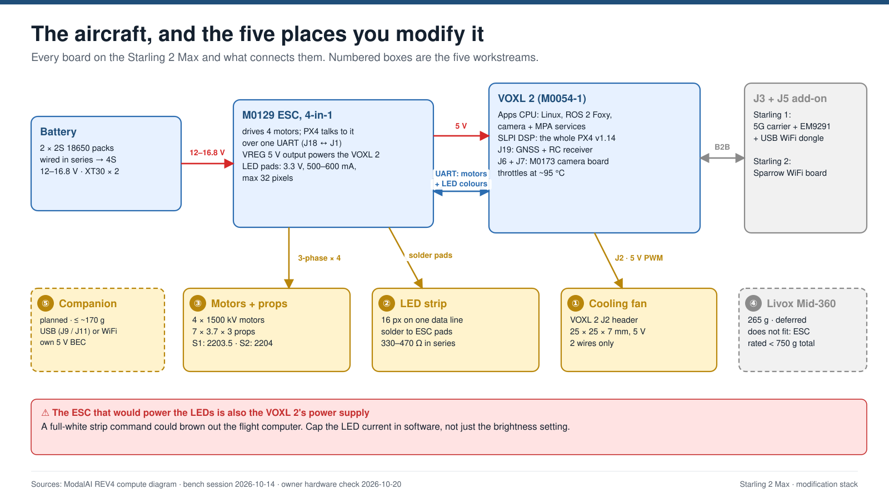
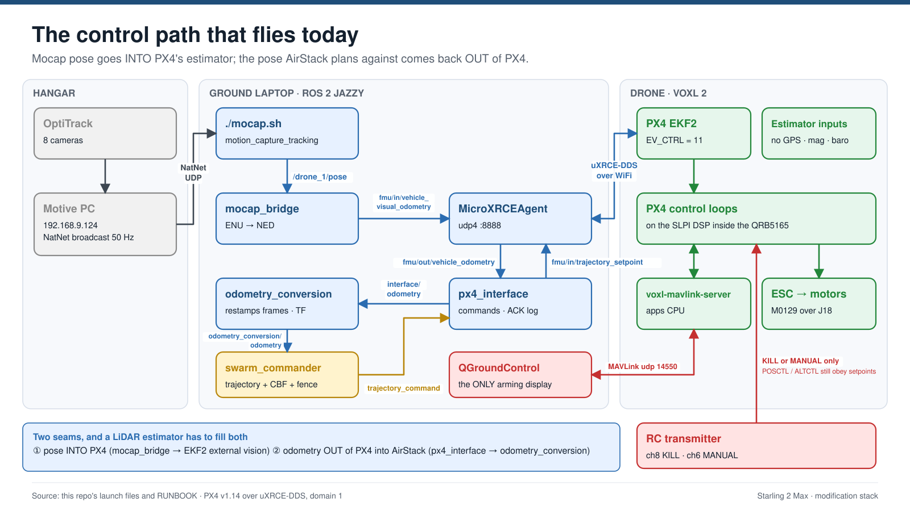

# Starling 2 Max — hardware reference

What the aircraft physically is, as of **2026-10-20**. Current facts only.

| Looking for… | Go to |
|---|---|
| What to buy, build or check next | [MODIFICATIONS.md](MODIFICATIONS.md) |
| How each fact below was established, sources, corrections | [hardware investigation report](../reports/Starling%202%20Max%20hardware%20investigation.md) |
| Software versions, IPs, PX4 params, SKU strings | [CONFIG.md](CONFIG.md) §Airframe inventory |
| Shopping sheet to print | [sourcing/parts-sourcing.pdf](../sourcing/parts-sourcing.pdf) |

**Marks:** ✅ inspected or measured on our aircraft · 📄 from ModalAI documentation, not inspected · ⏳ open

---

## At a glance



| | |
|---|---|
| Airframe | ModalAI **Starling 2 Max**, airframe code **D0012**. Not "Starling Max 2", and not the smaller Starling 2 (D0014). Order spares by part number, never by store search |
| Takeoff mass | 566 g 📄 |
| **Mass limit** | **< 750 g all-up**: the M0129 ESC's rating 📄. That leaves **~184 g** for everything you add. The datasheet's "500 g payload" contradicts its own "~930 g total" figure; treat 750 g as binding until ModalAI says otherwise |
| Battery | 2 × 2S 18650 packs, XT30 each, wired in series → 4S, 12–16.8 V ✅ |
| Motors / props | 1500 kV; 7 × 3.7 × 3 props (7 in, 3.7 pitch, 3 blades) on both aircraft ✅ |
| Motor spacing | 258 mm side to side, 193 mm front to back, 322 mm diagonal 📄 |
| Compute | VOXL 2, software reports **M0054-1** (QRB5165M) ✅. ModalAI's product photo shows an M0154 silkscreen; the two are functionally equivalent |
| Flight controller | **PX4 v1.14 on the SLPI DSP inside the QRB5165**. No separate flight-controller chip |
| ESC | **M0129** VOXL Mini 4-in-1 ✅. Also powers the VOXL 2 |
| Cameras | **C29**: 2 × AR0144 tracking, 2 × IMX412 hi-res, IRS2975 ToF ✅ |

## The two aircraft

| | Starling 1 (older) | Starling 2 (newer) |
|---|---|---|
| Frame revision | V1–V3 ✅ | V4 ✅ |
| Motors | 2203.5, black and gold | 2204, black |
| Frame / motor / feet part numbers | M10000929 / M10000073 / M10000868 | M10001459 / M10001367 / M10001460 |
| Add-on on `J3` + `J5` | 5G modem carrier (M0090-class) + EM9291 modem (unused) ✅ | Sparrow WiFi board (M0213-class; ModalAI's REV4 drawing says M0141) ✅ |
| WiFi | USB dongle TP-Link Archer TX20U on the carrier's `J12` → `wlan0` ✅ | built into the add-on board → `mlan0` + `uap0` hotspot ✅ |
| RC receiver | ELRS ✅ | Ghost ✅ |
| GNSS + mag | fitted, unused indoors ✅ | fitted, unused indoors ✅ |
| Fan | none fitted ✅ | none fitted ✅ |

**Interchangeable:** compute board, ESC, props, cameras. **Not interchangeable:** frames and motors (two SKUs each).

---

## Layout and orientation


Seen from above, **front to the right**, scaled from ModalAI's product photo.

- **Rear-facing edge** ✅: VOXL 2 `J4` and `J9`; ESC `J1`, VREG pads and LED pads.
- **Stack, top to bottom:** `J3`/`J5` add-on board → VOXL 2 (top face up) → M0173 camera board (on `J6`/`J7`) → ESC (power face up).
  - ✅ The ESC is under the VOXL 2, with its LED pads reachable below the `J18` cable.
  - ⏳ Which way up each board sits is inferred: the VOXL 2's from ModalAI's photo, the ESC's from motor-corner matching. A side photo of the stack would confirm both.
- **Motor numbering (PX4 Quad X):** M1 front-right CCW · M2 rear-left CCW · M3 front-left CW · M4 rear-right CW.
- **ESC channel → motor:** ID0 → M2 · ID1 → M3 · ID2 → M1 · ID3 → M4 (`VOXL_ESC_FUNC1–4 = 102,103,101,104`) ✅. **ESC ID0 also drives the LED pad.**

## Wiring

Only **three connections matter**:

1. **Power.** Battery → ESC → ESC's 5 V regulator → VOXL 2 `J4`. Every 5 V peripheral hangs off the VOXL's rail behind that one cable.
2. **The ESC UART.** VOXL 2 `J18` ↔ ESC `J1`. All motor commands, all ESC telemetry **and every LED colour** cross this four-wire cable.
3. **The `J3` add-on.** The only link to the ground laptop: mocap pose, setpoints, QGC and LED commands all arrive through it.


Every board is drawn from above, front to the right, at 5 px = 1 mm. Downward faces are drawn as if seen through the board; ▶ marks show which way each cable leaves. Regenerate with `pictures/wiring/gen_*.py`.

> **TX/RX naming trap.** Each board labels pins from its own side. `J18-2 TX` (VOXL transmits) goes to `J1-2 RX` (ESC receives): the stock cable is straight-through, pin 2 to pin 2. If you re-pin a cable, match TX to RX, not pin number to pin number.

### Power

No step-up anywhere: everything is stepped **down** from the battery.

```
4S battery 12–16.8 V ──┬─▶ ESC main regulator ── 5.0 V, 5 A ──▶ VOXL 2 J4
                       │                                          ├─▶ VOXL 5 V rail ──▶ J19 GNSS + RC · add-ons (J2 empty)
                       │                                          └─▶ VOXL steps down to its chip rails (3.8 / 3.3 / 1.8 V…)
                       ├─▶ ESC AUX regulator ── 3.3 V, 500 mA ──▶ LED pad ➕ VAUX (unused in scenario B)
                       ├─▶ LED buck module (planned) ── 5 V ──▶ LED strip · fan · 74HCT125
                       └─▶ motor drivers
```

- **The 3.3 V is only the LED pad**, and scenario B doesn't use it.
- **Planned (scenario B):** a separate 5 V buck module off the battery pads feeds the LED strip, the fan and the 74HCT125, so a wiring fault on an arm can't reach the VOXL 2's supply. Details: [MODIFICATIONS.md](MODIFICATIONS.md#power-and-data-scenario-b-chosen-2026-10-22).
- **Adding a 5 V load** (LED strip on 5 V, a companion computer): use its own buck module from the battery pads. Never the ESC's main 5 V (it feeds the VOXL 2) or a VOXL connector (~1 A).

### Connectors

| Port | Type | Pins in use | Goes to | Notes |
|---|---|---|---|---|
| **ESC** battery pads | solder pads | + / − | 2 × XT30 in series | Unregulated 12–16.8 V. Never tap for 5 V parts |
| **ESC** VREG OUT | solder pads | + / − | VOXL `J4` | 5 V, 5 A |
| **ESC** `J1` | JST GH 4-pin (mate GHR-04V-S) | 1 NC · 2 RX · 3 TX · 4 GND | VOXL `J18` | The ESC's only real connector |
| **ESC** LED pads | solder pads, MCU face, behind the VREG pads | `G` · `⬇ OUT` · `➕ VAUX` | planned: `⬇ OUT` → 74HCT125 → strip; `G` common; `VAUX` unused | 3.3 V data, no level shifter; VAUX 3.3 V 📄, ⏳ not yet measured |
| **ESC** motor pads | solder pads | A / B / C × 4 | motors | `esc_address` 2,3,1,4 = PX4 motor numbers, not a fault |
| **VOXL** `J4` | 4-pin | 1 +5 V · 2 GND · 3–4 not wired | ESC VREG | 5 V ± 5 %, needs ≥ 6 A inrush |
| **VOXL** `J18` | 4-pin | 1 NC · 2 TX · 3 RX · 4 GND | ESC `J1` | 3.3 V UART, owned by PX4 on the SLPI |
| **VOXL** `J19` | 12-pin | 1 +5 V · 2–3 GNSS UART · 4–5 mag I²C · 6 GND · 10–11 RC UART · 12 GND | GNSS/mag + RC receiver | Pin 1's 5 V is shared by GNSS and RC |
| **VOXL** `J2` | JST SH 1.0 2-pin (mate SHR-02V-S) | 1 +5 V always on · 2 PWM-switched GND ≤ 400 mA | nothing | **Empty** ✅ and stays empty: the fan runs from the LED buck (scenario B) |
| **VOXL** `J3` + `J5` | 60-pin + 120-pin B2B, top face | — | add-on board | Both taken on both aircraft ✅ |
| **VOXL** `J6` + `J7` | 60-pin camera B2B | — | M0173 camera board | ✅ |
| **VOXL** `J9` | USB-C | ADB | laptop | ADB only ✅. Needs no network |
| **VOXL** `J8`, `J10` | camera B2B, SPI | — | nothing | **Empty** ✅ |
| **M0090 carrier** (S1) | — | M.2 (EM9291) · `J11` USB 3 10-pin · `J12` USB 2 4-pin | VOXL `J3` + `J5` | `J12` → WiFi dongle ✅ · **`J11` free** |
| **WiFi board** (S2) | — | `J1` 60-pin to VOXL · U.FL antennas | VOXL `J3` + `J5` | Connects to `J5` too ✅, although ModalAI's M0213 page lists `J3` only |
| **RC receiver** | 4-wire | Ghost: TX only · ELRS: TX + RX | VOXL `J19` 1/10/11/12 | |
| **M0173** | camera B2B + micro-coax | MCBL-00084 coax; ToF via M0171 + M0177 flex | VOXL `J6` + `J7` | Cabling as ModalAI's REV4 drawing ✅ |

### Signal paths

| Signal | Path |
|---|---|
| **Motor command** | `swarm_commander` → `px4_interface` (laptop) → uXRCE-DDS udp 8888 → WiFi → `J3` → apps CPU → SLPI (PX4) → `J18` → ESC `J1` → motors |
| **Mocap pose** | OptiTrack → Motive → NatNet → `mocap_bridge` (laptop) → uXRCE-DDS → WiFi → `J3` → SLPI → EKF2 |
| **RC kill / MANUAL** | handset → receiver → `J19-11` → SLPI (PX4) → `J18` → ESC. **No WiFi, no laptop**: the safety path |
| **LED colour** | `led_controller` (laptop) → UDP 47900 → WiFi → `svg_led_daemon` (apps CPU) → FIFO (S1) or MAVLink TUNNEL (S2) → PX4 `voxl_esc` → `J18` → ESC ID0 → `⬇ OUT` pad → strip |
| **LED heartbeat** | `svg_led_daemon` → UDP 47901 → laptop (the laptop firewall must allow 47901) |
| **QGC** | PX4 → `voxl-mavlink-server` (apps CPU) → WiFi → QGC udp 14550 |
| **Debug** | laptop → USB-C → `J9` → `adb shell` |

Two consequences of the LED path:
- **The LED colour rides the motor UART.** PX4 stamps its own status-LED bits into every motor packet, which is why `svg_led_daemon` mutes them at start.
- **If PX4 is down, the strip can't change colour.**



---

## Electrical and thermal limits

| Thing | Limit | |
|---|---|---|
| All-up mass | < 750 g (ESC rating) | 📄 |
| ESC LED pad (VAUX) | 3.3 V default, 500–600 mA; 5 V select disabled in firmware | 📄 (unused in scenario B) |
| ESC LED data | 3.3 V from ESC ID0, no level shifter; WS2812/NeoPixel protocol, RGB or RGBW | 📄 |
| LED pixel count | ≤ 32 (firmware) | 📄 |
| ESC main 5 V output | 5 A, shared with the VOXL 2 | 📄 |
| VOXL 5 V connector outputs | ~1 A each, not all at once | 📄 |
| `J2` fan return | ≤ ~400 mA, low-side PWM | 📄 |
| VOXL 2 temperature | flags at 90 °C, throttles near 95 °C | 📄 ✅ seen at 95–102 °C |
| Thermal zones | `soc` reads a constant 50.0: placeholder. Use `cpu-*`, `apc-*`, `ddr-*` | ✅ |
| PX4 EKF2 (v1.14) | one external-vision input: `vehicle_visual_odometry` | 📄 |

## Room to add hardware

What is left for a companion computer or other add-ons. Plan: [MODIFICATIONS.md](MODIFICATIONS.md) ⑤.

| Resource | Available | Notes |
|---|---|---|
| **Mass** | **~184 g** to the ESC's 750 g (~170 g after the LED strip and fan) | Binding limit |
| `J3` + `J5` (expansion connectors) | **none**: add-on board on both aircraft | Rules out the M0062 Ethernet add-on |
| `J11`, USB 3 on the 5G carrier | **free on Starling 1** | Wired link for a companion (USB-Ethernet adapter) |
| `J9`, USB-C | both aircraft | ADB today. Can also act as a USB network device (NCM) |
| `J8` camera connector, `J10` SPI | free | Not useful for a companion link |
| 5 V supply | **not from the aircraft** | ESC 5 V feeds the VOXL 2; VOXL connector outputs are ~1 A. Use a 5 V buck module (or BEC) off the 4S battery |
| Battery tap | the ESC battery pads, or an XT30 Y-lead | 12–16.8 V |
| Ethernet | **none** on the VOXL 2 | |

## Identify an aircraft over ADB

Plug into `J9` and run `adb shell`. No network is needed. `scripts/identify_drone.sh <label>` runs all of this in one go and saves a transcript.

| Question | Command | Reading |
|---|---|---|
| Board | `voxl-version` | `hw platform: M0054`; `mach.var 1.0` = `-1` (QRB5165M), `1.2` = `-2` (4-camera cap) |
| SKU | `voxl-version` | `SKU:` line, recent voxl-suite only. No line → look at the motors |
| WiFi / modem | `ip -br link` · `lsusb` · `dmesg \| grep -i -E 'mwlan\|rtl\|sierra'` | `wlan0` = dongle, `mlan0` = WiFi board, `wwan0` = modem |
| Cameras | `grep -E '"name"\|"type"' /etc/modalai/voxl-camera-server.conf` | five sensors including `pmd-tof-liow2` = C29 |
| ESC | `ls /usr/share/modalai/voxl-esc-params/D0012_Starling_MAX/` | `m0129` in the filenames |
| ESC live | `px4-listener esc_status` | four ESCs, ~16 V on a full pack |

---

## ModalAI reference drawings

Copied locally from ModalAI's public documentation (retrieved 2026-10-09) so they render offline. The source link is under each image.


*VOXL 2 connectors, top and bottom faces, red dots on pin 1. ModalAI draws the bottom face as seen from below. — <https://docs.modalai.com/voxl2-connectors/>*


*ModalAI's D0012/D0014 compute wiring diagram (REV4): cable pinouts, battery-in-series arrangement, camera configurations C26–C28. — <https://docs.modalai.com/voxl2-d0014/>*


*M0129 ESC, power face (left) and MCU face (right) with the NeoPixel pads. — <https://docs.modalai.com/voxl-mini-esc-datasheet/>*


*VOXL 2 outline 70 × 36 mm. `imu_px4` at (29.75, 25.75) mm, `imu_apps` at (4.50, 12.00). Axes: X left, Y up, **Z into the board**: reconcile any external pose source against this. — <https://docs.modalai.com/voxl2-mechanical-drawings/>*


*Bottom-face outline, for fan clearance. — <https://docs.modalai.com/voxl2-mechanical-drawings/>*


*M0213 WiFi board with the Sparrow module (Starling 2's add-on is this class). — <https://www.modalai.com/collections/add-ons/products/m0141>*


*Both variants print `M0054-1`; only the chip cover tells `QRB5165M` (-1) from `QSM8250` (-2). — <https://docs.modalai.com/m0054-versions/>*


*Starling 2 Max V3 CAD render. — <https://forum.modalai.com/topic/5052/starling-2-max-cad>*


*Top-down product photo the airframe layout drawing is traced from. — <https://www.modalai.com/products/starling-2-max>*


*IMX412 hi-res and AR0144 tracking cameras. — <https://www.modalai.com/products/starling-2-max>*
