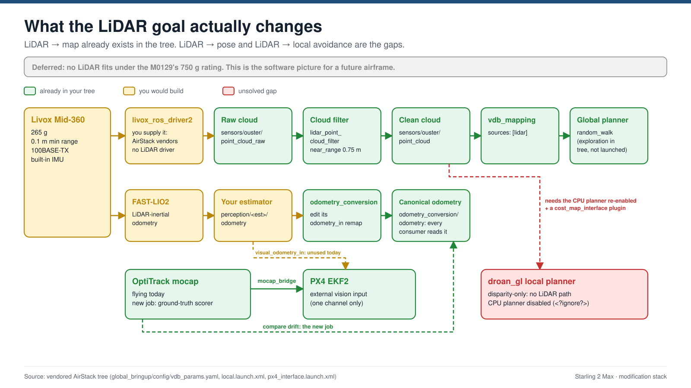

# Starling 2 Max hardware investigation (2026-10-09 → 2026-10-20)

**This is the record**: how each hardware fact was established, what was believed before, and the sources. It is not where to look things up.

| For… | Go to |
|---|---|
| Current facts: boards, connectors, wiring, limits | [docs/HARDWARE.md](../docs/HARDWARE.md) |
| What to buy, build or check next | [docs/MODIFICATIONS.md](../docs/MODIFICATIONS.md) |
| More compute onboard | [Onboard compute alternatives 2026-10-20](Onboard%20compute%20alternatives%202026-10-20.md) |
| Raw desk research behind this report | `research_notes/Starling Max 2 modification stack/` |

**Contents:** [Timeline](#timeline) · [Corrections log](#corrections-log) · [Identification evidence](#identification-evidence) · [Bench session results](#bench-session-results-2026-10-14) · [LED strip background](#led-strip-background) · [Thermal investigation](#thermal-investigation) · [Propeller research](#propeller-research) · [LiDAR research (deferred)](#lidar-research-deferred) · [Companion computer research](#companion-computer-research) · [Procurement research](#procurement-research) · [Lessons](#lessons)

---

## Timeline

| Date | What happened | Main outcome |
|---|---|---|
| 2026-10-09 | Desk research on LEDs, cooling, props, board identity, LiDAR and AirStack integration. Vendor drawings copied into `pictures/modalai/` and `pictures/livox/` | The four workstreams scoped; the questions only the hardware could answer were listed |
| 2026-10-14 | **ADB bench session on both aircraft**: `scripts/identify_drone.sh`, `probe_led_fan.sh`, thermal runs. Transcripts in `drone-backups/ident-*.txt` | Board, ESC, WiFi hardware, airframe revisions, cameras and software baselines settled; thermal cause found |
| 2026-10-20 | **Owner's hardware inspection**: connectors, the Starling 1 modem carrier, arm size, receivers. Onboard-compute research | Wiring confirmed; M0151 assumption overturned; ESC 750 g rating found, which rules out LiDAR on this airframe |

## Corrections log

Every belief that turned out wrong, so it isn't repeated.

| Earlier belief | What is true | Evidence | Date |
|---|---|---|---|
| The aircraft is a "Starling Max 2" | **Starling 2 Max**, airframe D0012. The "Starling 2" (D0014) is a smaller 230 mm aircraft, and an older "Starling" uses 120 mm props | ModalAI datasheets; a customer bought Sentinel props that didn't fit ([forum post 23859](https://forum.modalai.com/post/23859)) | 10-09 |
| Getting LiDAR into AirStack's map is the hard part | Already the default path in the vendored tree. The gaps are LiDAR → pose and LiDAR → local avoidance | `global_bringup/config/vdb_params.yaml` reads `sources: [lidar]` | 10-09 |
| The newer aircraft has WiFi built into its VOXL 2 | **VOXL 2 has no WiFi**; both aircraft use add-on boards | ModalAI feature matrix: built-in WiFi "No"; `dmesg` shows `MWLAN` on Starling 2 | 10-14 |
| The two aircraft have different compute boards | **Same board**, M0054-1; they differ in add-ons, frame and software | `voxl-version`, sysfs `machine=1 variant=0` on both | 10-14 |
| The ESC is an M0138 (`svg_led_daemon.py:62`) | **M0129** VOXL Mini ESC. M0138 is a 6S ESC; these aircraft are 4S | `m0129` in both aircraft's ESC parameter filenames | 10-14 |
| A fan is the fix for the heat | **CPU load is the cause**: two unused services | Stopping them: 95 °C → 43.8 °C | 10-14 |
| The 10-14 temperatures are a baseline | **Not valid**: an external fan was blowing on every reading | Bench notes | 10-14 |
| Starling 1's dongle is on an M0151 USB adapter | On **`J12` (USB 2) of an M0090-class 5G carrier** that holds an EM9291 | Owner saw the card and traced the cable; dongle at USB `1-1.4` behind a hub | 10-20 |
| "Neither aircraft is an M0154" | Software can't separate M0054-1 from M0154-1; ModalAI's product photo shows M0154 | ModalAI photo; ModalAI: "functionally equivalent" | 10-20 |
| `J3` is on the VOXL 2's bottom face | **Top face**, with `J19`, `J2`, `J5`, `J10` | ModalAI connector drawing | 10-20 |
| `J5` is free on Starling 2 | The WiFi board connects to `J3` **and** `J5` on both aircraft | Owner check | 10-20 |
| The M0173 uses `J6`/`J7`/`J8` | `J6` + `J7` only; `J8` is empty | Owner check | 10-20 |
| GNSS fitted? Starling 1 receiver? | GNSS fitted on both; Starling 1 ELRS, Starling 2 Ghost | Owner check | 10-20 |
| LED strip: 30 LED/m, 6 px on a ~200 mm arm | **60 LED/m, 4 px on a ~75 mm, ~10 mm wide arm** | Owner measurement (~104 mm by photo scale: re-check) | 10-20 |
| A 5 V supply alone fixes the 3.3 V LED pad | It also needs a **74HCT125** buffer: a 5 V strip needs ~3.5 V data | WS2812B/SK6812 input threshold | 10-20 |
| A Mid-360 fits the "500 g payload" | ESC rated **< 750 g all-up** → ~184 g margin; Mid-360 is 265 g | [ModalAI M0129 page](https://www.modalai.com/products/voxl-esc-mini) | 10-20 |
| A Jetson could replace the VOXL 2, or run its firmware | PX4 runs on the SLPI DSP inside the QRB5165; a Jetson has neither. A companion rides **alongside** the VOXL 2 | VOXL 2 architecture; PX4 docs | 10-20 |
| More onboard compute needs a Jetson | The VOXL 2's CPU is roughly an Orin Nano's; its two unused services waste ~1.4 cores. A Jetson (~170–200 g) is at or over the 750 g limit | Compute research | 10-20 |

---

## Identification evidence

Both aircraft were probed over ADB on `J9` (USB-C), which needs no network, router or mocap.

### Compute board

- `voxl-version`: `hw platform: M0054`, `mach.var: 1.0.1` on both. sysfs `/sys/module/voxl_platform_mod/parameters/{machine,variant}` = 1, 0. `voxl-platform` returns `M0054`; hostname `m0054`.
- `mach.var` 1.0 = the `-1` assembly (QRB5165M); 1.2 would be the `-2` (QSM8250, capped at four cameras) ([ModalAI](https://docs.modalai.com/m0054-versions/)).
- The Starling 2 Max datasheet lists "VOXL 2, M0154"; ModalAI says "M0054-1 and M0154-1 are functionally equivalent" ([product page](https://www.modalai.com/products/voxl-2)). ModalAI's own Starling 2 Max product photo shows an `M0154` silkscreen, so the software string may not tell them apart.

### Airframe revision

- Starling 2: SKU `MRB-D0012-4-V4-C29-T9-M36-X0` → **V4**.
- Starling 1: no `SKU:` line (voxl-suite 1.4.1 predates it). Identified as **V1–V3** from its black-and-gold 2203.5 motors and narrower mount spacing.
- ModalAI: V1–V3 and V4 frames are "not interchangeable"; V4 has wider motor spacing and black 2204 motors ([store](https://www.modalai.com/products/starling-2-max-replacement-parts)). Frames US$249.99, motors US$49.99.
- No serial-number lookup or revision changelog exists. For a third aircraft without a SKU line: look at the motors, or email ModalAI the serial.

### Cameras

- Five cameras on each, all enabled: `ar0144` tracking front/down, `imx412` hi-res front/down, `pmd-tof-liow2` ToF (sensor ID 0x2975, Infineon IRS2975) → **C29**.
- Live ToF pipes: `tof`, `tof_depth`, `tof_ir`, `tof_pc`; Starling 1 also `voa_pc_out`.

### WiFi, modem and the `J3`/`J5` add-on

| | Starling 1 | Starling 2 |
|---|---|---|
| Interface | `wlan0`, `rtl8852bu` | `mlan0` + `uap0` |
| Evidence | `lsusb` `35bc:0108` (TP-Link TX20U after `usb_modeswitch`) at USB `1-1.4`, behind a hub | `dmesg`: `wlan: Loading MWLAN driver` → Marvell/NXP |
| Board | M0090-class 5G carrier; dongle on its `J12` (owner, 10-20) | Sparrow/M0213-class WiFi board |
| Modem | Sierra EM9291 (`wwan0`, `cdc_mbim`, USB `2-1.1`), down. `voxl-modem.conf` wrongly says `quectel` | none: `lsusb` shows only root hubs |
| State on 10-14 | dongle bound; association not tested that day | never joined: `wpa_supplicant@mlan0` dead, `uap0` up as hotspot 192.168.8.1 |

- No ModalAI source uses the name `mlan0`; every doc says `wlan0`. The `MWLAN` driver settled what the board is.
- A buyer reports newer units ship with a Sparrow board and older ones with an M0151 + USB dongle ([post 25386](https://forum.modalai.com/post/25386)). Starling 1 is a third variant: dongle on the modem carrier.
- The Sparrow board: Bots Unlimited SP-01-100, dual-band 802.11ac 2×2 ([M0213](https://docs.modalai.com/m0213/)). M0213 replaced the M0141 ([thread 5309](https://forum.modalai.com/topic/5309/m0213-wifi-board-pinout-and-availability.md)), which ModalAI's REV4 drawing still shows, so Starling 2's exact revision is open. ModalAI's M0213 page lists only the `J3` mate, but the owner sees `J5` used too.
- M0090-3-02 is ModalAI's EM9291 carrier: `J2`/`J4` mate to VOXL `J3`/`J5`; `J11` USB 3, `J12` USB 2 ([datasheet](https://docs.modalai.com/5G-Modem-datasheet/)). The M0067 shares the layout. Glue hides the part number; the visible "2021" is most likely the design copyright year.
- Some Starling 2 Max SKUs ship with no WiFi, or a Microhard modem instead ([thread 5246](https://forum.modalai.com/topic/5246/starling-2-max-not-detecting-wifi-hardware.md)).

### ESC

- Both aircraft carry `/usr/share/modalai/voxl-esc-params/D0012_Starling_MAX/` with `esc_params_m0129_custom_2204_1500kv_7x3.7x3.xml` and `esc_params_m0129_f2203_5_1500kv_7x3.7x3.xml`.
- ModalAI staff: the Starling 2 Max uses M0129-5 or -65 ([forum](https://forum.modalai.com/topic/4334/starling-2-max-main-voltage/3)). The dash variant is undetermined and changes nothing buildable.
- The `M0138` comment in `svg_led_daemon.py:62` most likely came from the neighbouring `voxl-esc-tools/m0138_custom_firmware_for_dyno_bench/` directory. The code is unaffected: ESC ID 0 is right for either board.
- ModalAI's M0129 page: "Designed for vehicles **under 750 g** (under 500 g in FPV use)"; 2–4S; main output 5 V at 5 A; AUX 3.3 / 5 V at 500 mA; PWM input on test points only, disabled in stock firmware ([page](https://www.modalai.com/products/voxl-esc-mini); [forum post 16006](https://forum.modalai.com/post/16006)).

### Board orientation (drawings in HARDWARE.md)

- **Owner, 10-20:** VOXL `J4`/`J9` and ESC `J1`/VREG/LED pads face the rear; the ESC sits under the VOXL 2.
- **VOXL 2 top face up:** inferred. ModalAI's product photo shows the shield over the SIP toward the front, consistent with `J4`/`J9` at the rear only this way up.
- **ESC power face up:** inferred. With `J1` to the rear, it's the only way up where each ESC corner sits next to its motor (ID1 front-left = M3, ID2 front-right = M1, ID0 rear-left = M2, ID3 rear-right = M4).

### Software baselines

Recorded in [CONFIG.md](../docs/CONFIG.md) §Airframe inventory. Two findings worth keeping here:
- PX4 is v1.14 on both, which confirms the px4_msgs v1.15 mismatch.
- **Neither aircraft's apt state is trustworthy.** Both print `WARNING: repo file has changed since last update`, and Starling 2 claims a last update of 2023-03-02, impossible for its packages. No casual `apt upgrade`.

## Bench session results (2026-10-14)

Findings not covered above.

| Item | Result |
|---|---|
| ESC telemetry | `px4-listener esc_status` works without stopping PX4; four ESCs at 16.07–16.09 V; `esc_address` 2,3,1,4 = PX4 motor numbers |
| Fan | none on `J2`; `voxl-fan` absent on both (voxl-utils 1.4.4 / 2.0.4); `J2` has no tach line |
| Fan control | Starling 1: `"fan_mode": "auto"` in `voxl-cpu-monitor.conf` (`auto/off/max/slow`). Starling 2: newer schema (`en_auto_pitmode`, governors), no `fan_mode`. `pwmchip0/2/5` are on the PMIC; none confirmed as `J2` |
| Thermal zones | `soc` = 50.0 always (placeholder). Real: `cpu-*`, `apc-*`, `ddr-*`. `voxl-cpu-monitor` flags > 90 °C |
| Power mode | Starling 2 in low-power mode (`en_auto_pitmode: true`, cpu7 max 960 MHz vs 2.84 GHz on Starling 1) |
| LED toolchain | `voxl-esc`, `voxl-led`, `voxl-send-neopixel-cmd`, `voxl-esc-neopixel-test.py` on both. `modal_io_bridge` FIFO only on Starling 1; `voxl_setup_led.sh:74` falls back to a MAVLink TUNNEL (payload type 201). `svg_led_daemon.py` not installed on either |
| `MAV_SYS_ID` | 1 on both: fine flying one at a time, broken for simultaneous flight |

Never measured: ESC firmware version (`esc_status` doesn't carry it; old notes say 39.21), whether `voxl-px4` streams `ONBOARD_COMPUTER_STATUS`, kernel trip points, in-flight thermal behaviour.

---

## LED strip background

*The M0129's MCU face (right) carries the Neopixel Output pads (GND / ←OUT / VAUX) beside the AUX regulator. — <https://docs.modalai.com/voxl-mini-esc-datasheet/>*

**The ESC's LED output** ([VOXL Mini ESC datasheet](https://docs.modalai.com/voxl-mini-esc-datasheet/)):
- One output: a bare solder pad `⬇`, 3.3 V logic straight off ESC ID0 pin PB6, no level shifter.
- Power pad `➕`: AUX regulator, "3.3 V or 5.0 V at 500 mA, defaulting to 3.3 V". The `AUX_VREG_ADJUST` GPIO is marked "(disabled)". Staff: real capability "500–600 mA", 5 V control "disabled at the moment" ([forum](https://forum.modalai.com/topic/3702/neopixel-gpio-control-on-voxl2-spi-port)).
- 32-pixel cap, on both ESC datasheets and confirmed by staff.
- RGBW works although neither datasheet says so: "3 bytes for each LED in case of RGB, or 4 bytes per LED for RGBW" ([forum](https://forum.modalai.com/topic/4724/neopixel-integration-with-px4)), matching packet types 25 / 26.

**Why the 3.3 V pad is usable.**
- WS2812B/SK6812 need data ≥ 0.7 × supply: ~3.5 V on a 5 V strip. One SK6812 sheet says 3.4 V minimum ([OPSCO](https://wmsc.lcsc.com/wmsc/upload/file/pdf/v2/lcsc/2306280930_OPSCO-Optoelectronics-SK6812RGBP8_C7423115.pdf)). The ESC can't drive that.
- Adafruit's two remedies are to lower the strip's supply or add a level shifter ([guide](https://learn.adafruit.com/adafruit-neopixel-uberguide/powering-neopixels)).
- Running the strip from the 3.3 V pad is the first remedy for free: the threshold drops to ~2.3 V. The strip is dimmer and warmer, which suits a mocap room.
- The 5 V route needs both a BEC and a push-pull buffer (74AHCT125 class; not a TXS-style bidirectional shifter).
- Below ~3.5 V supply the strip is under-spec, so the far pixels may dim or colour-shift. Hence the backup kit.

**Power.** The M0129 also powers the VOXL 2 ([forum](https://forum.modalai.com/topic/4334/starling-2-max-main-voltage/3)). Adafruit: ~20 mA per pixel mixed, 60 mA full white. A full-white, full-brightness command overruns the pad on the board that feeds the flight computer, which is why a software cap is needed.

**Chipsets.** WS2812B and SK6812 (RGB or RGBW) are right. APA102 / SK9822 / WS2801 need a clock line; WS2815 is 12 V.

**Local stock (10-09).**
- Cytron SG: 1 m 60 LED/m SK6812/WS2812B silicone strip, S$13.21, 14.5 mm wide, so too wide for the arms ([Cytron](https://sg.cytron.io/p-sk6812-60-led-silicon-strip-1m)).
- Kuriosity.sg: from S$8.60.
- Sun-Light, Sim Lim Tower #03-09: S$32.70/m.
- No SK6812 RGBW seller found in Singapore.

**Mocap hypothesis, untested.** White or warm-white LED dice might show in Motive as ghost markers. No source measures IR from WS2812B/SK6812, hence the off/R/G/B/white test in MODIFICATIONS.md.

---

## Thermal investigation

**Measured on Starling 1, 2026-10-14.**
- 8-core load in still air: **102.7 °C**, holding ~101 °C, cpu7 throttled 2.84 GHz → 845 MHz.
- **The first sample, before any load, already read 95 °C.**
- Idle `top`: `voxl-camera-server` 95 %, `voxl-qvio-server` 48 %, `px4` 31 %.
- Stopping the first two: **95 °C → 43.8 °C in 20 s**. An external fan came on at the same time, but a desk fan alone took a similar board only from 104 °C to ~80 °C. Hottest part afterwards: the PMIC at 45 °C.
- Starling 2 already had `en_vio: false` and qvio inactive.

**Field reports match.**
- A Starling 2 Max owner saw ~104 °C idle on a desk with camera-server ~184 % and qvio ~96 %, plus "Preflight Fail: High Accelerometer Bias". ModalAI said the heat **may cause the bias error** ([topic 5330](https://forum.modalai.com/topic/5330/questions-on-starling-2-max.md)). That makes it a flight-safety issue, not just performance.
- Another thread: `voxl-portal` open in a browser heats the board fast ([topic 4484](https://forum.modalai.com/topic/4484/temperature-issue-with-voxl-2.md)).

**Fan hardware.**
- ModalAI specifies the Sunon MC25060V1-000U-A99 (25 × 25 × 6.9 mm, 5 V, ~3 CFM, ~5 g) with an SHR-02V-S plug on `J2`.
- `J2`: pin 1 permanent 5 V, pin 2 PWM-switched return ≤ ~400 mA ([thermal](https://docs.modalai.com/voxl2-thermal-performance/); [connectors](https://docs.modalai.com/voxl2-connectors/)).
- Low-side switching is why the fan must be 2-wire. A generic 2-wire fan is low-risk; the failure mode is "won't spin at `slow`", not damage.
- Conflict: one 2024 forum thread says `J2` is "always on" with no software control ([topic 3228](https://forum.modalai.com/topic/3228/starling-fan-attachment-and-optimization)). Unresolved.

**ModalAI cautions.**
- No heatsink recommendation; a bare heatsink without airflow "will effectively become a large thermal capacitor" ([topic 5103](https://forum.modalai.com/topic/5103/voxl2-thermal-throttling-and-heat-dissipation-methods)).
- B2B connectors are on the secondary side so add-ons don't block airflow over the memory, the bottleneck ([topic 2233](https://forum.modalai.com/topic/2233/voxl2-thermal-management)).
- Prop wash beat vapour chambers and heatsinks "by many degrees C". So a fan's value is on the bench, pre-arm and between flights.

**Fan vibration: inference only.** A constant-speed fan gives one fixed vibration peak a notch filter can remove. No source covers fan vibration coupling into a flight-controller IMU on any platform.

**Two reading errors that caught us.** The `soc` zone is a constant 50.0. And cpu7 reads 845 MHz both when throttling at 95 °C and when idle at 44 °C, so only low clock **plus** high temperature means throttling.

---

## Propeller research

- Prop spec comes from the aircraft itself: ESC parameter filenames end `7x3.7x3`, matching the datasheet's "180 mm tri-blade". 322 mm diagonal + 180 mm = the stated 512 mm tip to tip.
- ModalAI sells one SKU, MRP-D0012-1-00, US$29.99 for 4. Bore, hub, weight and maker are unpublished. ModalAI's docs disagree on whether it folds. A separate "Propeller Nuts" part (M10001405) implies a threaded shaft.
- **The motors are deliberately small** (2203.5 / 2204 at 1500 kV on 7 in; Gemfan suggests 2806.5+ for 7 in) for 40–55 min endurance. Hence: never higher pitch.
- **OddityRC**, 60 Paya Lebar Rd #11-53, stocks four Gemfan 7 in props: 7035-2, 7035-3, **7037-3**, 7040-3 ([OddityRC](https://oddityrc.com/collections/7-props)). The 7037-3: 178.8 mm, 3.7 pitch, 8.7 g, M5 bore, 7 mm hub. Prices in USD; "5–8 days" suggests not same-day stock.
- If the stock prop is a folder, the closest match is the Gemfan F7036 folding (US$7.49 / set, no Singapore source) ([RDQ](https://racedayquads.com/products/gemfan-f7036-folding-3-blade-propeller-set-of-4-black)).
- **No source endorses a third-party prop.** ModalAI: the ESC is "tuned for this motor + propeller… I do not recommend trying to fix this by modifying ESC parameters" ([post 19806](https://forum.modalai.com/post/19806)). A different pitch or weight moves `CA_ROTORn_CT`, `MPC_THR_HOVER` and the rate gains.

---

## LiDAR research (deferred)

On hold: no LiDAR fits under the M0129's 750 g rating. Kept as the software and integration groundwork for a future airframe.

### The sensor

| Livox Mid-360 | |
|---|---|
| Mass · body | **265 g** · 65 × 65 × 60 mm |
| Power | 6.5 W, **9–27 V** (runs off 4S directly; fuse it; never from a VOXL 5 V rail) |
| FOV · min range | 360° × (−7°…+52°) · 0.1 m |
| Interface | 100BASE-TX Ethernet; built-in IMU; PTPv2 / GPS sync |
| Price | US$852–899 overseas (list US$979); no Singapore dealer; budget S$1,100–1,300 + freight + GST |

Siblings are 2–4× heavier. Lighter non-Livox options: Hesai JT16 (< 200 g, 4.3 W) and Unitree L1 (~230 g, 360° × 90°); both lose the Livox/FAST-LIO toolchain. The original Mid-360 is reportedly being phased out for the Mid-360S/L ([DroneXL](https://dronexl.co/2026/09/21/livox-mid-360l-lidar-half-point-rate-robots/)): check driver support for whichever you buy.

*Strongly asymmetric FOV: 52° up, 7° down. Mounted upright it sees the roof, not the floor. — <https://daystar.lenovo.com/docs/en/daystarBot/V2.4/SDKOverview/Services/LiDARServices.html>*

*65 × 65 × 60 mm, 73 mm across the connector boss. — same source*

**Mounting.** Top-centre mast is the only option. A stiff mount, not a soft one: 265 g on a compliant mast is a pendulum that may resonate at 5–15 Hz (inference).

### Connecting it

- VOXL 2 has no Ethernet. The sanctioned add-on, M0062 (US$259.99), is a USB-to-Ethernet bridge on `J3` + `J5`, both taken on our aircraft. Users report dead units, no link LEDs and an unreliable USB 3 port ([M0062](https://docs.modalai.com/m0062-2/)).
- ModalAI staff twice said they have **no experience with this sensor** ([thread 4196](https://forum.modalai.com/topic/4196/clarification-on-livox-mid-360-lidar-compatibility-with-voxl-2-on-starling-2-max-outdoor-drone.md)). No ModalAI LiDAR driver exists.
- Time sync: software PTP with the VOXL 2 as grandmaster is enough.

*M0062 Ethernet + USB hub add-on. — <https://docs.modalai.com/m0062-datasheet/>*

### Software

- `livox_ros_driver2` builds on Foxy, Humble and Jazzy.
- **FAST-LIO2** is the default choice and the only one with ARM benchmarks: 45–66 ms/scan on a weaker A73 board ([paper](https://ar5iv.labs.arxiv.org/html/2107.06829)). On the same chip as the VOXL 2, FAST-LIVO2 ran at 78 ms/frame (see the compute report).
- FAST-LIO2 and Point-LIO are ROS 1. GLIM wants a GPU. VOXL 2 can't run Ubuntu 22.04 ([forum](https://forum.modalai.com/topic/2664/sentinel-voxl2-update-ubuntu-from-18-04-to-20-04.md)).
- **EKF2 (PX4 v1.14) reads one external-vision topic**, `vehicle_visual_odometry`, so mocap and SLAM can't both feed it.
  - `EKF2_EV_CTRL=11` suits mocap; 15 adds velocity.
  - Re-measure `EKF2_EV_DELAY` (onboard LIO plausibly 70–130 ms).
  - With `EV_NOISE_MD=0` the EKF uses the message's variance; `EV_QMIN` lets PX4 drop a sick solution.
  - The bridge must bump `reset_counter` on pose jumps.
- **Degeneracy:** a hangar is near worst case. Put boxes and equipment in the volume. If external vision stops with GPS and baro off, the estimator has nothing.
- **Validation:** fly mocap markers on the sensor, record both, run FAST-LIO2 offline against mocap, then shadow-run live for weeks before any cutover. Mocap is worth more as the scorer than as a second input.

### AirStack's side

- **Already there:** Isaac Sim Ouster → `sensors/ouster/point_cloud_raw` → `lidar_point_cloud_filter` → `sensors/ouster/point_cloud` → `vdb_mapping_ros2` → global planner. CI tests only the filter chain, only under Isaac Sim.
- **A real Livox needs three pieces:**
  - the driver;
  - a remap onto `sensors/ouster/point_cloud_raw`;
  - a URDF link for the TF frame.
  - Traps: config topics must be absolute, the YAML needs `allow_substs="true"`, and best-effort vs reliable QoS mismatches drop everything.
- **Two pose injection points:**
  1. AirStack reads **`/{robot}/odometry_conversion/odometry`**, not the `/{robot}/odometry` that `AGENTS.md` claims. Publish `perception/<est>/odometry` and edit `odometry_conversion`'s `odometry_in` remap in `px4_interface.launch.xml` / `drone_interface.launch.xml`.
  2. PX4's EKF2 seam is the commented-out `visual_odometry_in` remap in `px4_interface.launch.xml`. Mocap occupies it today, which is what makes mocap-as-scorer possible.
- **Local avoidance:** `droan_gl` is disparity-only with no plugin seam. The CPU `droan_local_planner` is disabled (`<?ignore ?>`), and the `cost_map_interface` README is empty.
- **Caveats:** the branch predates upstream's stacks-and-modules refactor. TF ownership is undesigned: `world → map` is static, `odometry_conversion` owns `map → base_link`, and SLAM packages want `map → odom`.

---

## Companion computer research

Done 2026-10-20 by three parallel research passes. The full report, with prices, sources and a decision tree, is [Onboard compute alternatives 2026-10-20](Onboard%20compute%20alternatives%202026-10-20.md); the plan is in [MODIFICATIONS.md](../docs/MODIFICATIONS.md) ⑤.

**The VOXL 2 can't be swapped for a Jetson.**
- PX4 runs on the SLPI DSP inside the QRB5165, and `J18`/`J19` wire straight to it.
- Removing the VOXL 2 removes the autopilot, the five cameras (the M0173 only mates with VOXL 2) and the provisioning.
- Upstream PX4 builds the M0129's `voxl_esc` driver only for ModalAI boards; the one public Pixhawk attempt never spun the motors ([topic 3774](https://forum.modalai.com/topic/3774/voxl-esc-mini-integration-with-px4-on-pixhawk6x-and-kakuteh7.md)).
- VOXL firmware can't be flashed onto a Jetson: it's a Qualcomm board support package, and PX4 lives on a DSP the Jetson doesn't have.

**What the VOXL 2 can already do.**
- 8 Kryo 585 cores (up to 2.84 GHz), Adreno 650 GPU, 8 GB.
- Published runs on this chip: acados NMPC at 150 Hz ([arXiv 2411.11982](https://arxiv.org/html/2411.11982)); FAST-LIVO2 at 78 ms/frame on an RB5 ([arXiv 2408.14035](https://arxiv.org/html/2408.14035)).
- Neural nets: YOLOv5 at 23 ms on the GPU; YOLOv8/v11 fall back to the CPU. No Hexagon delegate, so most of the "15 TOPS" is unreachable ([voxl-tflite-server](https://docs.modalai.com/voxl-tflite-server/)).
- Hard ceiling: **Ubuntu 18.04 / ROS 2 Foxy**. Humble only in Docker, without camera or DSP access.

**Companions that fit the mass budget.** Pi CM5 on ARK Just A Pi (~45 g), Pi 5 + Hailo AI HAT+ (~80 g), RK3588S boards (~25–85 g). A Jetson is ~150–175 g flight-ready on any carrier, ~170–200 g installed. NVIDIA raised Jetson prices up to 101 % in July 2026 ([CNX](https://cnx-software.com/2026/07/22/nvidia-increases-the-price-of-jetson-modules-and-devkits-by-up-to-101)).

**The link is the real obstacle.** `J3` + `J5` are taken. A ModalAI staff recipe turns `J9` into a USB network device ([post 25777](https://forum.modalai.com/post/25777)), untested with a Pi or Jetson as host. On Starling 1 the carrier's free `J11` takes a USB-Ethernet adapter.

**Successor board.** VOXL 3 (M0254, QCS6490) runs Ubuntu 24.04 natively but has *less* AI compute (12 TOPS), takes battery power directly on a moved `J4`, and has no availability date ([feature matrix](https://docs.modalai.com/m0254-feature-matrix/)). It fixes the OS, not the compute.

---

## Procurement research

- **ModalAI** ships from San Diego in USD; no Asia-Pacific distributor found. "Each order ships the selected part only". Everything is ECCN **EAR99**, HTS 8807.30 / 8806.22, origin USA: an ordinary commercial export.
- **GST:** 9 % on essentially all imports; ≤ S$400 collected by GST-registered sellers, above that at clearance ([Sovos](https://sovos.com/en-gb/blog/vat/singapore-updates-low-value-goods-gst-policy)).
- **Livox:** no authorised Singapore dealer (livoxtech.com/dealer 404s). Nearest is Optimus Control, Kuala Lumpur. Ask cs@livoxtech.com.
- **Export control:** Singapore's Strategic Goods (Control) Act covers export, not import. Taking a LiDAR-equipped aircraft abroad might need a check ([Customs](https://www.customs.gov.sg/permits-and-licences/trade-controls-and-prohibitions/strategic-goods-control/)). No CAAS rule on importing drone parts was found, and none confirming the absence either.

---

## Lessons

- **ModalAI's documentation lags its hardware.** The aircraft's own filesystem (ESC parameter filenames, `dmesg`) and the forum were more reliable than the datasheets.
- **The cheapest check usually wins.** Motor colour identified the frame revision; a traced cable identified the modem carrier; one product page (the ESC's 750 g rating) settled the LiDAR question before any compute analysis.
- **Newer SDK ≠ better equipped.** Starling 2's newer SDK dropped the fan control Starling 1 still has.
- **Mocap is the asset to keep.** As LiDAR or other estimators arrive, its best use is as the independent ground truth that shows how far a new estimator drifts.
