# Two measurements still gate Starling 2 Max modifications

Most of the bench checks this report originally depended on were run over ADB on 2026-10-14, and they settle the compute board, the ESC, the WiFi hardware, the airframe revisions and the camera set. **The aircraft is a ModalAI "Starling 2 Max" (airframe code D0012), not a "Starling Max 2"** ([ModalAI docs](https://docs.modalai.com/starling-2-max-datasheet/)), and searching the transposed name is itself a sourcing trap. Both of your aircraft report `hw platform: M0054` with `mach.var: 1.0.1`, which is a VOXL 2 M0054-1 on QRB5165M silicon, so the difference between Starling 1 (older, USB WiFi dongle) and Starling 2 (newer, B2B WiFi board) is a **WiFi accessory swap, not a compute-board change**. The ESC on both is the **M0129**, which follows from ModalAI's own shipped D0012 parameter filenames; the `M0138` in `svg_led_daemon.py` is wrong. The owner also already has a **ToF depth sensor on both aircraft**: both are C29 builds with an Infineon IRS2975 ToF (`pmd-tof-liow2`) among five detected cameras. Two things still gate work. The first is a **multimeter reading of the LED power pad** with the aircraft powered; the datasheet says 3.3 V and nothing has measured it. The second is a **still-air thermal number**: every temperature taken so far was under an external fan, so the fan decision is open until the soak finishes. On LiDAR, **LiDAR → `vdb_mapping` → global planning is already the default, CI-tested path in the AirStack branch you fly**, so it is not new work. What is new work is LiDAR → pose, and it does not fit this airframe: ModalAI rates the M0129 ESC for vehicles under 750 g ([ModalAI M0129](https://www.modalai.com/products/voxl-esc-mini)), which leaves ~184 g above the 566 g takeoff weight, and a Livox Mid-360 alone is 265 g. See [Onboard compute alternatives 2026-10-20](Onboard%20compute%20alternatives%202026-10-20.md).

## Four framing errors worth correcting before you order anything

The naming error is the cheapest to fix and the most expensive to leave alone. ModalAI publishes a "Starling 2 Max Datasheet" (D0012) and a separate "Starling 2 Datasheet" for a smaller 230 mm-diagonal aircraft (D0014) ([ModalAI docs](https://docs.modalai.com/starling-2-max-datasheet/); [ModalAI docs](https://docs.modalai.com/starling-2-datasheet/)), and there is a third, much older "Starling" running **1504 motors and 120 mm propellers** ([ModalAI store](https://www.modalai.com/products/starling-replacement-motors)). A customer with four Starling 2 Max drones bought Sentinel propellers (MPR-D0006-1-01) in September 2025 and they did not fit ([forum.modalai.com post 23859](https://forum.modalai.com/post/23859)). Order by MPN via direct link, never by store search.

The second correction concerns your two airframes. One has an integrated WiFi board and one a USB dongle, which reads as two generations of compute board, and it is not. ModalAI's feature matrix lists **built-in WiFi: No for both VOXL 2 and VOXL 2 Mini** ([ModalAI docs](https://docs.modalai.com/voxl2-mini-feature-matrix/)), and the VOXL 2 "by itself doesn't have Wi-Fi or a LAN port to keep the core size and weight low" ([ModalAI beta docs](https://beta-docs.modalai.com/voxl2-wifidongle-user-guide)). Measurement on 2026-10-14 shows both aircraft report the identical M0054-1 board: `voxl-platform` returns `M0054`, the hostname is `m0054`, and sysfs reports `machine=1 variant=0`. That rules out the `-2` / QSM8250 assembly, so neither aircraft is capped at four cameras. The add-on hardware is the difference. Starling 1 brings up `wlan0` on the `rtl8852bu` driver, with `lsusb` showing `35bc:0108` (a TP-Link Archer TX20U after `usb_modeswitch`), The dongle sits behind a USB hub (path `1-1.4`). On 2026-10-20 the owner saw a Sierra EM9291 5G card stacked on Starling 1's VOXL 2; ModalAI's carrier for that card is the M0090, which has its own USB hub. The owner then traced the dongle's cable to the carrier's `J12`, its USB 2 header. So the dongle plugs into the M0090-class carrier, not into the M0151 USB3/UART adapter this report originally assumed. Glue hides the part number. Starling 2 brings up `mlan0` and `uap0`, and `dmesg` shows the MWLAN driver loading, which is Marvell/NXP silicon of the kind used on the M0213 VOXL 2 WiFi Addon. That addon is built on the Bots Unlimited SP-01-100 "Sparrow" 22×22 mm LGA module, dual-band 802.11ac 2×2 MIMO, and its own J1 mates to the VOXL 2's 60-pin legacy B2B at J3 ([ModalAI docs](https://docs.modalai.com/m0213/)). ModalAI staff say it replaces an earlier M0141 board ([forum.modalai.com thread 5309](https://forum.modalai.com/topic/5309/m0213-wifi-board-pinout-and-availability.md)), so the exact board revision on Starling 2 is not established. The driver evidence agrees with a buyer's report that newer Starling 2 Max units ship with a Sparrow-based WiFi adapter board and older ones with the USB3.0/UART Expansion Adapter (M0151) ([forum.modalai.com post 25386](https://forum.modalai.com/post/25386)). Starling 1 is a third variant, with the dongle on the 5G modem carrier. Spares and procedures for the compute board are shared across both aircraft. The non-interchangeable split is the airframe: Starling 2 is a V4 (SKU `MRB-D0012-4-V4-C29-T9-M36-X0`), and Starling 1 is a V1–V3, identified from its black-and-gold 2203.5 motors and narrower mount spacing. ModalAI states that the two carbon-fibre frames are not interchangeable.

The third is the ESC part-number conflict in your own code. `svg_led_daemon.py` line 62 asserts the strip is driven on M0138, while ModalAI staff say M0129-5 or M0129-65 ([ModalAI forum](https://forum.modalai.com/topic/4334/starling-2-max-main-voltage/3)). The **ESC is the M0129**. Both aircraft carry `/usr/share/modalai/voxl-esc-params/D0012_Starling_MAX/`, and ModalAI's own parameter files in it name `m0129`. M0138 is also a 6S racing ESC, and this aircraft runs 4S. The comment most likely came from the neighbouring `voxl-esc-tools/m0138_custom_firmware_for_dyno_bench/` directory. The code is unaffected, because ESC ID 0 is correct for either board. The dash variant (-5 or -65) is undetermined and changes nothing buildable. This decides which datasheet governs the LED rail: the VOXL Mini ESC datasheet applies, with **one NeoPixel output, a 3.3 V default pad at 500 mA, the 5 V select GPIO documented as "(disabled)", a 32-pixel cap and bare solder pads only** ([ModalAI VOXL Mini ESC datasheet](https://docs.modalai.com/voxl-mini-esc-datasheet/)). The full-size Modal ESC's 5.0 V AUX does not apply ([ModalAI Modal ESC datasheet](https://docs.modalai.com/modal-esc-datasheet)). The 3.3 V figure is the datasheet's, and a multimeter reading on the live pad is still outstanding.

The fourth is the LiDAR framing, and it is the most valuable. Your own vendored tree already contains a complete LiDAR path: `global_bringup/config/vdb_params.yaml` reads `sources: [lidar]`, `topic: sensors/ouster/point_cloud`, `sensor_origin_frame: ouster`, with the stereo source commented out. Upstream states the same in prose, "the VDB map takes the filtered LiDAR cloud" ([adding_a_world_model_and_planner.md](https://raw.githubusercontent.com/castacks/AirStack/main/docs/robot/autonomy/adding_a_world_model_and_planner.md)), and the path is CI-tested (`tests/conftest.py` sets `ENABLE_LIDAR=true`). The exploration planner is a second consumer. Any plan that treats "get LiDAR into AirStack's map" as the hard part is solving a solved problem. The unsolved parts are LiDAR-derived *pose* and LiDAR-driven *local* avoidance.
## How it ties together

Three pictures, each drawn from your own tree plus ModalAI's documentation. The hardware sections below also carry ModalAI's and Livox's own drawings as primary reference — those images are reproduced from the vendors' public documentation for internal engineering use, each captioned with a link to the page it came from, and copied locally so they still render in the hangar with the WAN unplugged. The first is the aircraft and the four places these workstreams touch it; the second is the control path that flies today; the third is what the LiDAR goal actually changes. GitHub renders these natively — in a terminal pager they appear as code blocks.

### The aircraft, and the four places you are modifying it

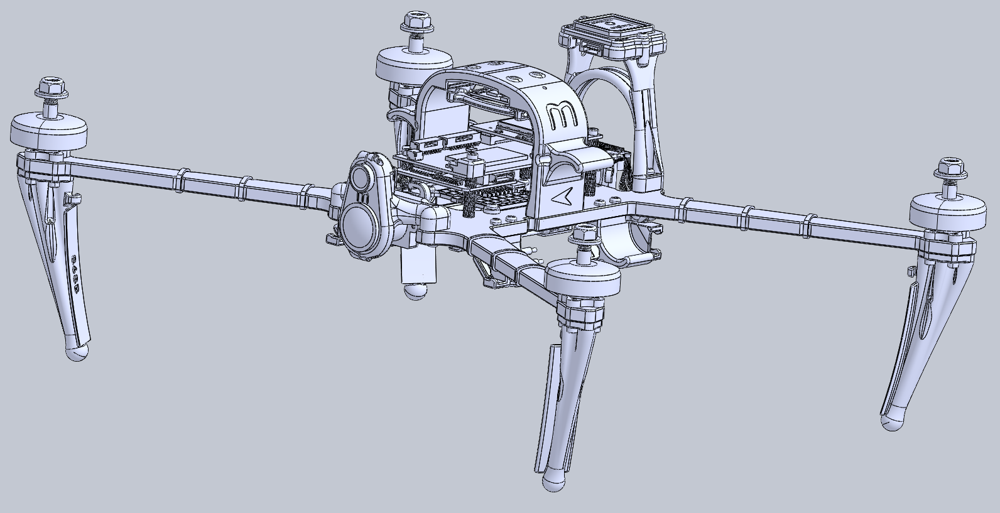

***The airframe.** ModalAI CAD render of a Starling 2 Max V3 (SKU `MRB-D0012-4-V3-C28-M36-T7-K0`) — ModalAI/Livox documentation, retrieved 2026-10-09. Source: <https://forum.modalai.com/topic/5052/starling-2-max-cad (ModalAI staff post #25481, accompanying the STEP file at developer.modalai.com/asset/6)>*


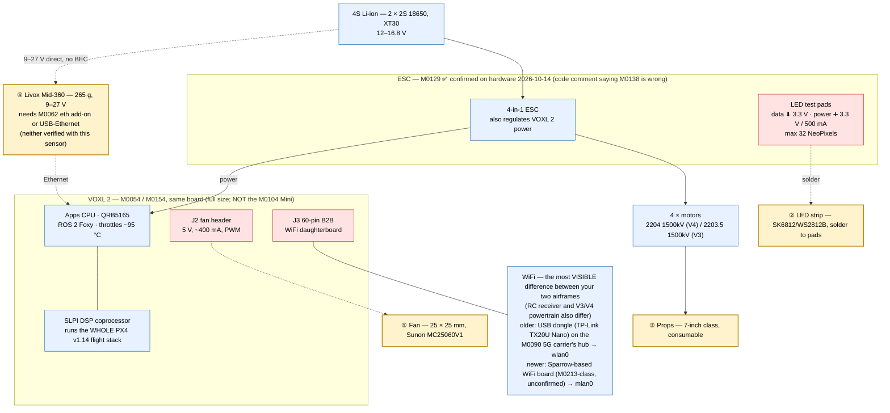

The numbered boxes are your four workstreams. Note what the diagram makes obvious and prose hides: **the ESC that would power your LED strip is also VOXL 2's power source**, which is why a full-white strip command is a flight-controller brown-out risk and not merely a bright light.

### Full wiring: every board, port and pin

The diagram above shows *what* gets modified. This one shows *how the boards physically talk to each other*. Pinouts come from ModalAI's D0012/D0014 REV4 compute wiring diagram (reproduced in the next section), the VOXL 2 connector page, the VOXL Mini ESC datasheet and the 2026-10-14 bench session. Anything drawn by ModalAI but not inspected on your two aircraft is marked ⚪.

The aircraft has only **three connections that matter**:

1. **Power.** Battery → ESC → ESC's own 5 V regulator → VOXL 2 `J4`. The VOXL 2 never sees battery voltage, and every 5 V peripheral hangs off the VOXL's local rail downstream of that one cable.
2. **The ESC UART.** VOXL 2 `J18` ↔ ESC `J1`. All motor commands, all ESC telemetry **and every LED colour** cross this one four-wire cable. The LED strip has no data wire of its own back to the VOXL.
3. **WiFi on `J3`.** This is the only link to the ground laptop. Every mocap pose, every setpoint, QGC traffic and the LED commands from the Basestation arrive through it.

Everything else is a sensor hanging off the VOXL 2. The two drawings below are to scale: the first shows where everything sits on the airframe, the second shows every board with its connectors at their real positions and what plugs into each one. Both are SVG files in `pictures/wiring/`. They're plain text and can be edited by hand.

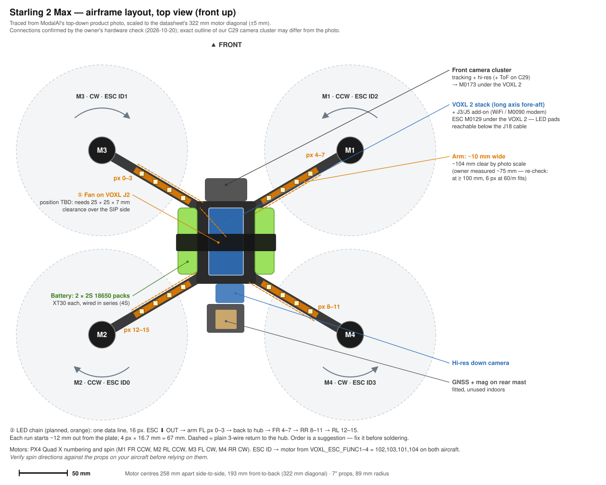

***Where everything sits.** Traced from ModalAI's top-down product photo and scaled to the datasheet's 322 mm motor diagonal. The motors sit 258 mm apart side to side but only 193 mm front to back, so the X is wide, not square. Orange shows the planned LED runs (4 px per arm, one daisy chain with plain-wire returns to the hub) and the fan. The ESC sits under the VOXL 2: the owner's 2026-10-20 check found its LED pads reachable just below the `J18` cable. The exact stack order and which VOXL 2 face points up still want a side photo, which would also give this drawing a side view.*

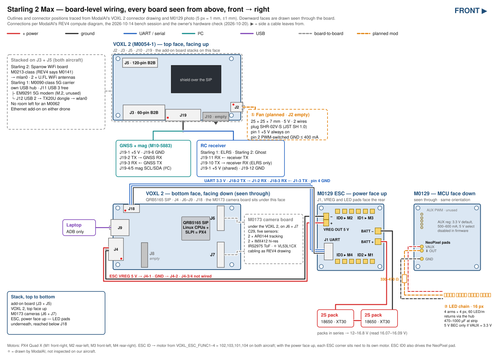

***Every board, every connector, every wire.** The VOXL 2 faces and the M0129 faces are drawn at 5 px = 1 mm, with connector positions traced from ModalAI's connector drawing and labelled photo. ModalAI draws the two VOXL 2 faces mirrored, so the left edge of one is the right edge of the other. Note the ESC-ID-to-motor mapping on the ESC pads: ESC ID0, the one that drives the NeoPixel pad, spins **M2, the rear-left motor**.*

**TX/RX naming trap.** VOXL 2 labels its header pins from its own side: `J18-2 TX` means "VOXL transmits here". The ESC labels its `J1` from *its* side, so the stock cable is straight-through (pin 2 to pin 2) and the crossover happens in the naming, not in the wire. If you ever re-pin a cable, match `TX` to `RX`, not pin number to pin number.

#### Connector by connector

| Board · port | Physical | Pins (as used on Starling 2 Max) | Goes to | Notes |
|---|---|---|---|---|
| **Battery** | 2 × XT30 | + / − per pack | ESC battery pads | Packs wired in series, which is what makes this the D0012 config |
| **ESC** battery pads | solder pads, top | `+++` / `---` | XT30 leads | Unregulated 12–16.8 V bus. Never tap it for 5 V parts |
| **ESC** VREG OUT | solder pads, top | + / − | VOXL 2 `J4` | Main regulator, 3.8 V or 5.0 V. 5.0 V here because `J4` wants 5 V ± 5 % with ≥ 6 A inrush |
| **ESC** `J1` | JST GH 4-pin, BM04B-GHS-TBT (mate GHR-04V-S) | 1 NC · 2 RX · 3 TX · 4 GND | VOXL 2 `J18` | The only true connector on the Mini ESC |
| **ESC** NeoPixel pads | solder pads, bottom | `GND` · `⬇ OUT` · `➕ VAUX` | LED strip | `OUT` is ESC ID0's PB6 with no level shifter. `VAUX` is the AUX regulator, 3.3 V by default, 500–600 mA. **Not yet measured** |
| **ESC** motor pads | solder pads | A / B / C × 4 | motors | `esc_address` 2,3,1,4 are PX4 motor numbers, not a wiring fault |
| **ESC** AUX PWM | solder pads | A0–A3 | nothing | Unused |
| **VOXL 2** `J4` | 4-pin R/A | 1 +5 V · 2 GND · 3–4 NC | ESC VREG OUT | Pins 3–4 are the power-monitor I²C, left unwired in REV4 |
| **VOXL 2** `J18` | 4-pin | 1 NC · 2 TX · 3 RX · 4 GND | ESC `J1` | 3.3 V UART, driven by PX4 on the SLPI |
| **VOXL 2** `J19` | 12-pin | 1 +5 V · 2 GNSS TX · 3 GNSS RX · 4 MAG SCL · 5 MAG SDA · 6 GND · 7–9 NC · 10 RC TX · 11 RC RX · 12 GND | GNSS/mag + RC receiver | One harness splits to both. Pin 1's 5 V is **shared** by GNSS and RC, which is why the fan must not go here |
| **VOXL 2** `J2` | JST SH 1.0 2-pin, SM02B-SRSS-TB (mate SHR-02V-S) | 1 +5 V permanent · 2 PWM-switched return, ≈ 400 mA | ① fan | **Empty on both aircraft** (owner check 2026-10-20). No tach line exists |
| **VOXL 2** `J3` | 60-pin legacy B2B, top side (same face as `J19`) | USB1 (USB 3.1), UART, I²C, GPIO, 5 V | WiFi board (Starling 2) / M0090 carrier (Starling 1) | The add-on board is connected to `J3` **and** `J5` on both aircraft (owner check 2026-10-20). See the M0062 caution below |
| **VOXL 2** `J6`, `J7` | 60-pin B2B × 2 | 2 × 4-lane MIPI CSI + CCI + rails each | M0173 front-end | Owner check 2026-10-20: the M0173 uses `J6` and `J7` only; `J8` is empty |
| **VOXL 2** `J9` | USB-C | USB0, ADB | laptop | Used only for ADB (owner check 2026-10-20). Works with no network, no router and no mocap. This is how the 2026-10-14 bench session ran |
| **VOXL 2** `J5` | 120-pin B2B | — | the J3 add-on board, on both aircraft | Owner check 2026-10-20. An M0062 Ethernet add-on would need it too |
| **VOXL 2** `J8`, `J10` | 60-pin camera B2B, 8-pin SPI | — | nothing | Empty on both aircraft (owner check 2026-10-20) |
| **WiFi board** (Starling 2) | M0213-class | `J1` 60-pin QTH to VOXL `J3` · `J3` 12-pin GHS peripheral · `J2` BT U.FL · `J4`/`J5` WiFi path A/B U.FL | VOXL 2 `J3` + `J5` | The owner sees it connected to both `J3` and `J5`, although ModalAI's M0213 page lists only the 60-pin `J3` mate. ModalAI's REV4 drawing labels this slot **M0141**, the board M0213 replaced, so the exact revision on Starling 2 is still open |
| **M0090 5G carrier** (Starling 1) | M0090-3-02, 67.5 × 36 × 10 mm, 12.8 g + modem | `J2` → VOXL `J3` · `J4` → VOXL `J5` · M.2 slot (EM9291) · `J11` USB 3 10-pin · `J12` USB 2 4-pin · nano-SIM `J3` | VOXL 2 `J3` + `J5` | The owner saw an EM9291 on this aircraft on 2026-10-20, and M0090-3-02 is ModalAI's EM9291 carrier. The USB paths fit too: the dongle at `1-1.4` and the modem at `2-1.1` both sit behind a hub, which a plain adapter would not have. **Confirmed 2026-10-20:** the dongle's cable comes out of the carrier's `J12`, which ModalAI's datasheet lists as the M0090's 4-pin USB 2 header. That matches the dongle enumerating on the USB 2 bus (`1-1.4`). It is **not an M0151**, as earlier sections assumed. The part number is under glue, and the only legible marking is 2021, probably the design copyright year as on the VOXL 2's own "© 2021". ModalAI's datasheet gives the M0067 the same layout and headers, but the EM9291 makes M0090-3-02 the likely part. `J11` (USB 3, 10-pin) is free |
| **RC receiver** | 4-wire | Ghost: 1 NC · 2 TX · 3 5V · 4 GND · ELRS: 1 RX · 2 TX · 3 5V · 4 GND | VOXL 2 `J19` 1/10/11/12 | Starling 1: **ELRS**. Starling 2: **Ghost** (owner check 2026-10-20). Ghost needs only its TX line; ELRS uses both directions |
| **GNSS/mag** | 6-wire | 1 5V · 2 GND · 3 RX · 4 TX · 5 SDA · 6 SCL | VOXL 2 `J19` 1–6 | Fitted and connected on both aircraft (owner check 2026-10-20). Unused indoors |
| **M0173 front-end** | camera B2B + micro-coax | MCBL-00084-xx coax per camera, M0171 + M0177 flex for ToF | VOXL 2 `J6` + `J7` | Camera cabling matches ModalAI's REV4 drawing (owner check 2026-10-20). ModalAI draws C26/C27/C28 but not C29; C29 is C28 plus ToF, which matches the five sensors detected |

**M0062 caution (deferred LiDAR work).** The M0062 Ethernet/USB add-on plugs into `J3` **and** `J5`, and ModalAI says the M0213 WiFi board "is not meant to plug into any other board than VOXL 2 directly". On both aircraft the existing add-on board already uses `J3` and `J5`: the WiFi board on Starling 2, and on Starling 1 the M0090 modem carrier, whose hub is also what the WiFi dongle plugs into. Before buying an M0062 for the Mid-360, confirm it can coexist with whichever board is there. If it can't, the aircraft loses its ground link. *That conflict is inferred from the two connector pages, not tested.*

#### Following a signal end to end

The hardest thing to picture is which wires a command crosses. Here are the hops for each command:

| Signal | Path |
|---|---|
| **Motor command** | `swarm_commander` → `px4_interface` (laptop) → uXRCE-DDS, udp 8888 → WiFi → `J3` WiFi board → apps CPU → SLPI (PX4 control loops) → `J18` → ESC `J1` → 4 MCUs → motor pads → motors |
| **Mocap pose** | OptiTrack cameras → Motive PC → NatNet → laptop `mocap_bridge` → uXRCE-DDS → WiFi → `J3` → apps CPU → SLPI → EKF2 |
| **RC kill / MANUAL** | handset → radio → receiver → `J19-11` → SLPI (PX4) → `J18` → ESC. **It does not touch WiFi or the laptop**, which is why it's the safety path |
| **LED colour** | `led_controller` (laptop) → UDP 47900 → WiFi → `J3` → `svg_led_daemon` (apps CPU) → `modal_io_bridge` FIFO (Starling 1) or MAVLink TUNNEL (Starling 2) → PX4 `voxl_esc` driver on SLPI → `J18` → ESC `J1` → ESC ID0 MCU → PB6 → `⬇ OUT` pad → 330 Ω → strip DIN → pixel 0 → … → pixel 15 |
| **LED heartbeat** | `svg_led_daemon` → UDP 47901 → WiFi → laptop. This is the only reason the laptop firewall must allow 47901 |
| **QGC telemetry / arming** | PX4 (SLPI) → `voxl-mavlink-server` (apps CPU) → WiFi → QGC, udp 14550 |
| **Fan speed** | Starling 1: `voxl-cpu-monitor` (`fan_mode: auto`) → PWM → `J2` pin 2 low-side switch. Which `pwmchip` drives `J2` is unconfirmed; Starling 2 has no fan setting |
| **Provisioning / debug** | laptop → USB-C → `J9` → `adb shell`. No network involved |

Two consequences fall out of the LED row. First, **the LED strip shares the ESC UART with the motors**, so PX4 stamps its own status-LED bits into every motor packet; that is why `svg_led_daemon` mutes them at start. Second, **if PX4 is down, the strip can't change colour**, because every path to the ESC goes through PX4's `voxl_esc` driver.

### The control path that flies today

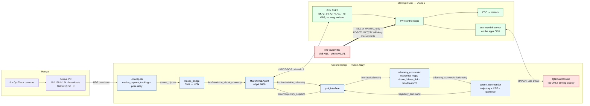

Two things worth reading off this. The mocap pose enters **PX4's estimator**, not AirStack's graph — which is why the drone can hold position at all. And the pose AirStack plans against comes back *out* of PX4 as `fmu/out/vehicle_odometry`, through `odometry_conversion`. Those are two separate seams, and the LiDAR goal has to fill both.

### What the LiDAR goal actually changes

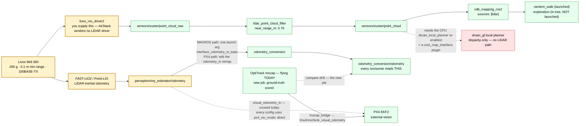

Green already exists in your tree — though only the LiDAR filter chain is CI-tested, and only under Isaac Sim. Amber is what you would build. Red is unsolved: `droan_gl` has no LiDAR path at all, and mocap's role changes from *the position source* to *the independent scorer* — which is the single most useful reframe in this report.
## Both aircraft carry the same VOXL 2; the frame, WiFi and software differ

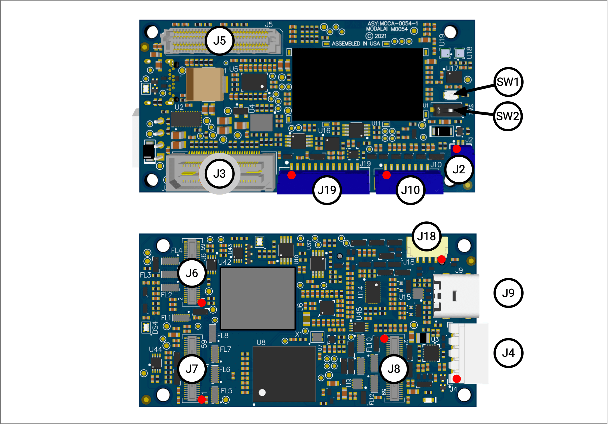

***Where J2 and J3 physically are.** VOXL 2 (M0054) top and bottom with every connector called out. J2 — the 5 V fan header — is at the far right of the top view, just right of J10. J3, the 60-pin board-to-board socket the WiFi add-on bolts to, is the large grey connector at bottom-left. Red dots mark pin 1 — ModalAI/Livox documentation, retrieved 2026-10-09. Source: <https://docs.modalai.com/voxl2-connectors/>*

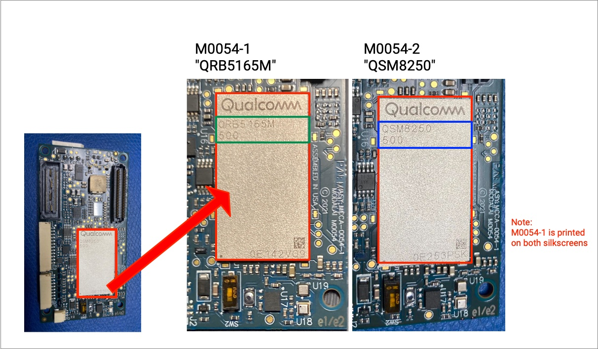

***The variant check the silkscreen can't give you.** The board is printed `M0054-1` on *both* variants; only the Qualcomm SIP cover distinguishes them — `QRB5165M` is the -1, `QSM8250` the -2 (capped at 4 concurrent cameras). Cross-check against `mach.var` from `voxl-version`: 1.0 = -1, 1.2 = -2 — ModalAI/Livox documentation, retrieved 2026-10-09. Source: <https://docs.modalai.com/m0054-versions/>*

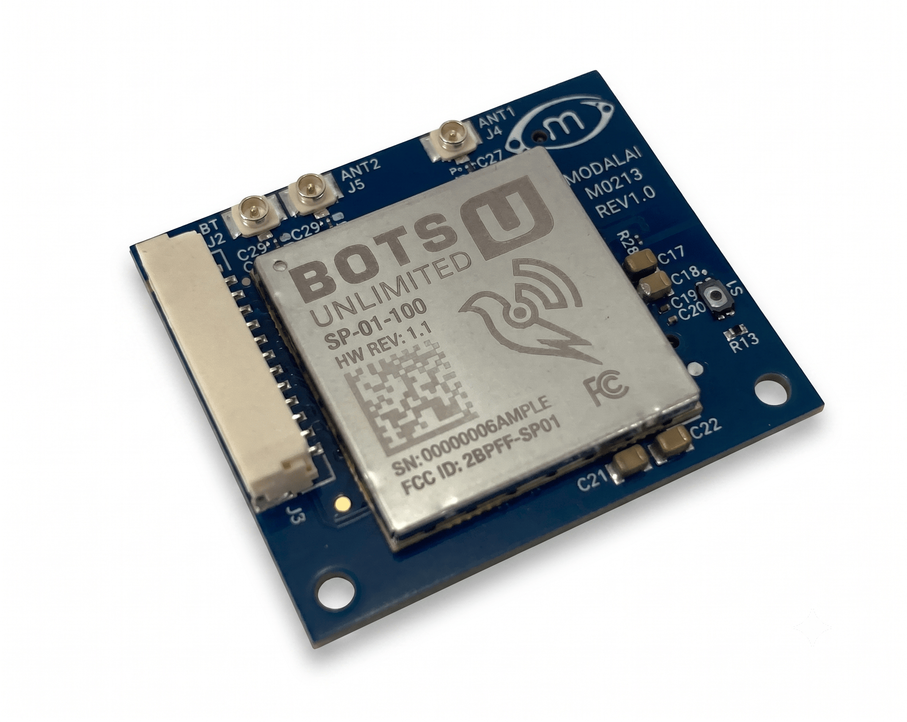

***Starling 2's WiFi.** The M0213 add-on carrying the Bots Unlimited SP-01-100 'Sparrow' LGA module (FCC ID 2BPFF-SP01) — a daughterboard on J3, *not* WiFi integrated into the VOXL 2 silicon — ModalAI/Livox documentation, retrieved 2026-10-09. Source: <https://www.modalai.com/collections/add-ons/products/m0141>*

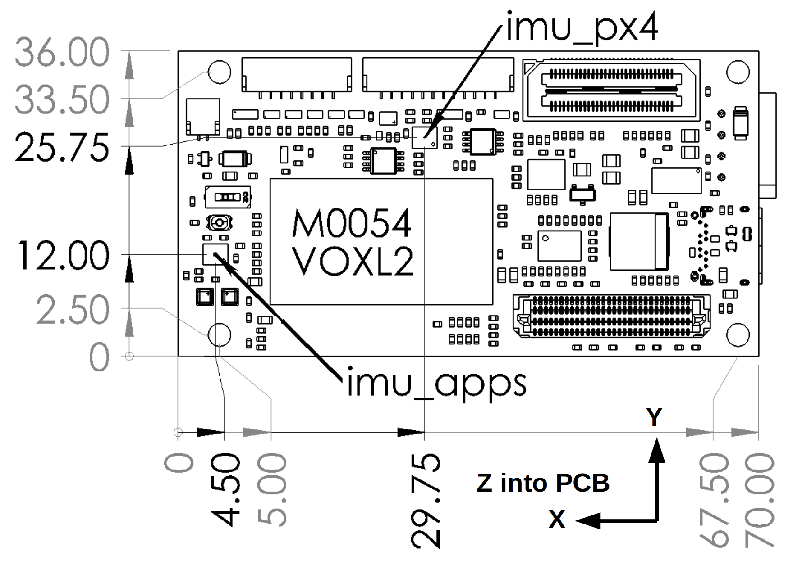

***Board frame and IMU placement.** 70.0 × 36.0 mm, mounting holes at 5.00/67.50 × 2.50/33.50 mm, with `imu_px4` at (29.75, 25.75) and `imu_apps` at (4.50, 12.00). The axis convention — X left, Y up, **Z into the PCB** — is what you reconcile any external pose source against — ModalAI/Livox documentation, retrieved 2026-10-09. Source: <https://docs.modalai.com/voxl2-mechanical-drawings/>*

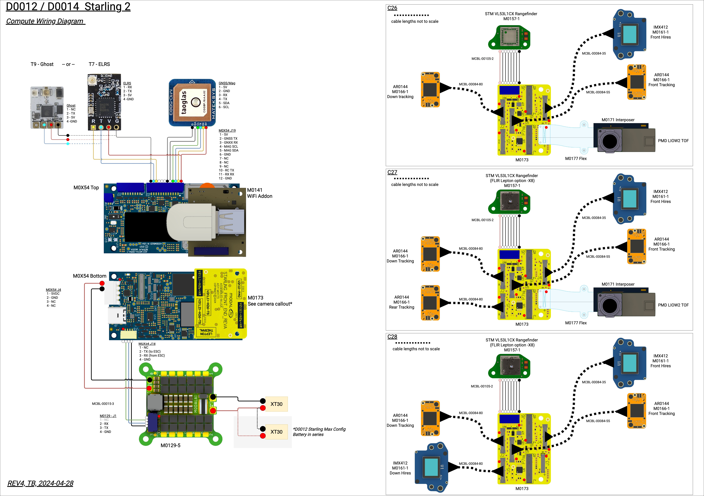

***How it is all wired.** ModalAI's own D0012/D0014 compute wiring diagram (REV4), including the D0012 dual-battery-in-series arrangement — ModalAI/Livox documentation, retrieved 2026-10-09. Source: <https://docs.modalai.com/voxl2-d0014/ — the page the Starling 2 Max datasheet links to from its "Hardware Wiring Diagram" section (https://docs.modalai.com/starling-2-max-datasheet/#hardware-wiring-diagram)>*

Both aircraft were identified on 2026-10-14 over ADB on the USB-C port. That route needs no network, no router, no DHCP lease and no mocap, so none of the lab infrastructure had to be up. Starling 1 is the older airframe with the USB WiFi dongle; Starling 2 is the newer one with the B2B WiFi board.

### Compute board

`voxl-version` reports `hw platform: M0054` and `mach.var: 1.0.1` on both aircraft, and sysfs agrees (`machine=1`, `variant=0`; the same values are at `/sys/module/voxl_platform_mod/parameters/machine` and `.../variant`). `voxl-platform` returns `M0054` and the hostname is `m0054` on both. Each is therefore a **VOXL 2 M0054-1 with QRB5165M silicon**. Neither is the `-2` QSM8250 assembly (so neither is capped at four concurrent cameras), and neither is a Mini. `voxl-version` does not separate the two airframes; it shows they share one board. The Starling 2 Max datasheet's critical-components table lists the flight controller as "VOXL 2, M0154" ([ModalAI docs](https://docs.modalai.com/starling-2-max-datasheet/)), but ModalAI states that "M0054-1 and M0154-1 are functionally equivalent" ([ModalAI VOXL 2 product page](https://www.modalai.com/products/voxl-2)). ModalAI's own Starling 2 Max product photo shows an `M0154` silkscreen, so the software string may not separate the two; read the silkscreen if it ever matters. There are no per-board code paths to maintain.

### Airframe revision and frames

| | Starling 1 | Starling 2 |
|---|---|---|
| SKU line | none (voxl-suite 1.4.1~beta3 predates SKU reporting) | `MRB-D0012-4-V4-C29-T9-M36-X0` |
| Frame revision | V1–V3, from the motors: black-and-gold 2203.5 1500 kV T-Motors, narrower mount spacing | V4, from the SKU |
| Frame / motor / feet | M10000929 / M10000073 / M10000868 | M10001459 / M10001367 / M10001460 |
| Camera config | C29 | C29 |
| Propellers | 7×3.7×3 (7 in, 3.7 pitch, 3 blades) | 7×3.7×3 |

Starling 1's revision came from looking at the motors, which are visible from outside without disassembly; where software cannot answer, the physical check is often the cheapest one. ModalAI states the V1–V3 and V4 carbon frames are "not interchangeable" and that V4 uses wider motor-mount spacing and black 2204 motors ([ModalAI store](https://www.modalai.com/products/starling-2-max-replacement-parts)). The two aircraft straddle that boundary, so spares are two frame SKUs and two motor SKUs. Both frames are US$249.99 and both motors US$49.99. The propeller size is read from the ESC parameter filenames (`...7x3.7x3.xml`) shipped for airframe D0012 and matches the datasheet's 180 mm tri-blade; the same prop fits both. There is no ModalAI serial-number lookup and no public revision changelog, so for a third aircraft without a SKU line the choices are the motors or an email to ModalAI support with the serial.

### Cameras

Each aircraft detects five cameras, all `enabled: true`: `ar0144` tracking_front, `imx412` hires_front, `imx412` hires_down, `pmd-tof-liow2` tof and `ar0144` tracking_down. The sensor IDs include 0x2975, the Infineon IRS2975 ToF. This is the C29 configuration, not C28, and both aircraft already own a short-range depth sensor. The `tof`, `tof_depth`, `tof_ir` and `tof_pc` pipes are live, and Starling 1 also exposes `voa_pc_out`.

### WiFi and modem

| | Starling 1 | Starling 2 |
|---|---|---|
| Interface | `wlan0`, driver `rtl8852bu` | `mlan0` plus `uap0` |
| Evidence | `lsusb` shows `35bc:0108` (TP-Link Archer TX20U after usb_modeswitch) behind a USB hub at `1-1.4`, most likely the M0090 modem carrier's | dmesg: `wlan: Loading MWLAN driver`, `Driver loaded successfully` |
| Silicon | Realtek | Marvell/NXP, the Sparrow/M0213-class B2B daughterboard |
| State on the bench | driver bound to `wlan0`; association to the lab SSID was not tested in this session | never joined: `mlan0` down, `wpa_supplicant@mlan0` dead, `uap0` up as its own hotspot at 192.168.8.1 |

The MWLAN driver message settles what the documentation could only imply: no ModalAI source uses the name `mlan0`, every doc and forum post says `wlan0`, and the B2B board is Marvell/NXP silicon. Some SKUs ship with no WiFi at all; one `MRB-D0012-4-V2-C28-T8-M11-X0` owner found a Microhard modem instead ([forum.modalai.com thread 5246](https://forum.modalai.com/topic/5246/starling-2-max-not-detecting-wifi-hardware.md)).

Only Starling 1 carries a cellular modem: `wwan0` on `cdc_mbim`, with dmesg reporting a Sierra Wireless EM9291 (a 5G modem) on `usb 2-1.1`. Starling 2's `lsusb` shows only root hubs. Starling 1's `/etc/modalai/voxl-modem.conf` names `"modem_type": "quectel"` (APN `sunsurf`) against Sierra hardware, and `wwan0` is down. The owner has seen the EM9291 card itself stacked on the VOXL 2. ModalAI's carrier for it, the M0090-3-02, occupies J3 and J5 and also hosts the WiFi dongle, so removing the unused modem would also cut off WiFi.

### Software baselines

The two installs are far apart, and the difference is larger than the hardware difference.

| | Starling 1 | Starling 2 |
|---|---|---|
| system-image | `1.8.02-M0054-14.1a-perf`, kernel built 2024-11-11 | `1.8.08-M0054-14.1a-perf`, kernel built 2026-05-14 |
| voxl-suite | `1.4.1~beta3`, dev channel (`dists/qrb5165/dev/`) | `1.6.4~beta5`, `sdk-1.6` channel |
| voxl-px4 | `1.14.0-2.0.94` | `1.14.0-2.0.142` |
| PX4 params loaded | 827 / 2162 | 872 / 2167 (110 before a reboot) |

PX4 is v1.14 on both, which confirms the px4_msgs v1.15 mismatch already documented. Neither aircraft's apt state is trustworthy: both print `WARNING: repo file has changed since last update`, and Starling 2's metadata claims a last update of 2023-03-02, impossible for its package versions. Do not run a casual `apt upgrade` on either.

### Reproducing this on a third aircraft

Connect over USB-C and run `adb shell`. `voxl-version` prints `hw platform:`, `mach.var:` and, on recent voxl-suite, the `SKU:` line, and `-j` emits JSON ([ModalAI docs](https://docs.modalai.com/voxl-version/)). `mach.var` 1.0 is the -1 (QRB5165M) and 1.2 the -2 (QSM8250), matching the SIP cover silkscreen ([ModalAI docs](https://docs.modalai.com/m0054-versions/)). `ip -br link`, `lsusb` and `dmesg | grep -i -E 'mwlan|rtl|sierra'` separate the dongle, B2B and modem cases. The part-number map is M0054 original full-size VOXL 2, M0154 refreshed full-size, M0104/M0204 VOXL 2 Mini. If there is no `SKU:` line, look at the motors.
## The LED strip is a soldering job onto a 3.3 V test point

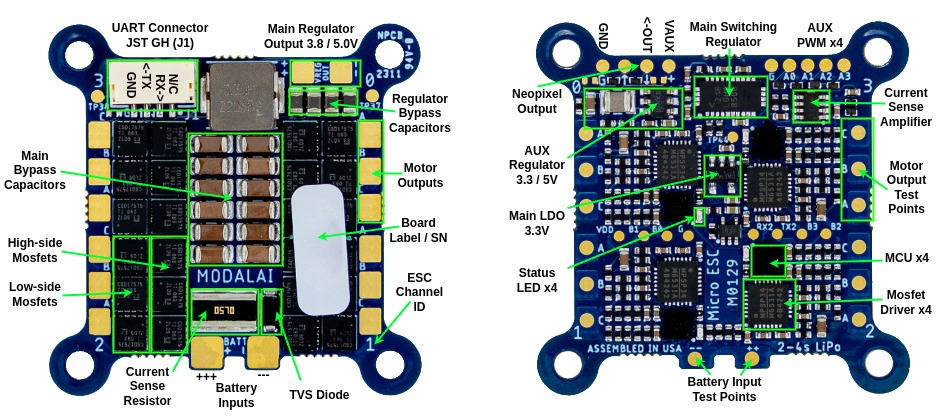

*This is the ESC in both aircraft. It was identified on 2026-10-14 from the drones' own parameter filenames, not from the silkscreen: both carry `/usr/share/modalai/voxl-esc-params/D0012_Starling_MAX/` containing `esc_params_m0129_custom_2204_1500kv_7x3.7x3.xml` and `esc_params_m0129_f2203_5_1500kv_7x3.7x3.xml`. The VOXL Mini 4-in-1 ESC reads `Micro ESC M0129`, and the bottom side (right) carries an explicit **Neopixel Output** callout beside the GND / ←OUT / VAUX pads, with the **AUX Regulator 3.3 / 5 V** immediately below it. This is the pad you solder to — ModalAI/Livox documentation, retrieved 2026-10-09. Source: <https://docs.modalai.com/voxl-mini-esc-datasheet/>*

The VOXL Mini ESC datasheet therefore governs. The `svg_led_daemon.py:62` comment naming the M0138 is wrong, probably misread from the neighbouring `voxl-esc-tools/m0138_custom_firmware_for_dyno_bench/` directory. The M0138 is a 6S racing ESC and these aircraft are 4S. The code is unaffected: `ESC_ID_DEFAULT = 0` is not a bug, because the `esc_address` values the aircraft report (2, 3, 1, 4) are PX4 motor numbers matching `VOXL_ESC_FUNC1..4 = 102,103,101,104`, not raw ESC IDs. The M0129 dash variant (-5 or -65) is undetermined, but both share the same NeoPixel output, rail and pixel cap, so nothing buildable depends on it.

Neither aircraft yet runs the LED daemon: `svg_led_daemon.py` and `svg-led.service` are not installed on either. The plumbing underneath is present on both: `voxl-send-neopixel-cmd`, `voxl-send-esc-gpio-cmd`, and ModalAI's bench script `/usr/share/modalai/voxl-esc-tools/voxl-esc-neopixel-test.py`. The `modal_io_bridge` FIFO exists only on Starling 1. On Starling 2, `voxl_setup_led.sh:74` detects the missing FIFO and sends the same ESC packet as a MAVLink TUNNEL (`MAV_TUNNEL_PAYLOAD_TYPE_MODALAI_ESC_UART_PASSTHRU`, read from the installed mavlink headers, default 201), so the difference is already handled.

The hardware is not plug-in. On the VOXL Mini ESC the NeoPixel output is a bare **solder test point** marked ⬇, carrying a single-wire 3.3 V signal straight off ESC ID0, MCU pin PB6, with **no level shifter on board**. A second test point marked ➕ supplies the LED array. The AUX regulator is "3.3 V or 5.0 V at 500 mA, **defaulting to 3.3 V**, software-controlled", with the `AUX_VREG_ADJUST` GPIO marked "(disabled)" ([ModalAI VOXL Mini ESC datasheet](https://docs.modalai.com/voxl-mini-esc-datasheet/)). ModalAI staff put the rail's real capability at "500-600 mA" and confirm the 5 V control feature "is disabled at the moment" ([ModalAI forum](https://forum.modalai.com/topic/3702/neopixel-gpio-control-on-voxl2-spi-port)). The one open item is the actual voltage on the ➕ pad, which the datasheet gives as 3.3 V. It has not been measured; the reading with a multimeter, aircraft powered, is planned for when the aircraft is opened to solder. Expect to tack a three-wire pigtail onto the ESC PCB and strain-relieve it; there is no documented connector option.

| Item | Value | Source |
|---|---|---|
| NeoPixel outputs | One | VOXL Mini ESC datasheet |
| LED supply pad | 3.3 V default, 500-600 mA; 5 V select disabled in firmware | Datasheet, ModalAI forum |
| Data signal | 3.3 V, ESC ID0, PB6, no level shifter | Datasheet |
| Pixel cap | 32 | Datasheet, ModalAI forum |
| Connection | Bare solder pads | Datasheet |

The 3.3 V rail is a blessing disguised as a limitation. WS2812B/SK6812 parts want **VIH ≥ 0.7 × VDD**, which is ~3.5 V on a 5 V strip — above what the ESC can drive, and an SK6812 RGBW spec sheet lists **VIH 3.4 V minimum at VDD = 5.0 V** ([OPSCO SK6812 datasheet](https://wmsc.lcsc.com/wmsc/upload/file/pdf/v2/lcsc/2306280930_OPSCO-Optoelectronics-SK6812RGBP8_C7423115.pdf); [Ledyi SK6812 RGBW specification](https://www.ledyilighting.com/wp-content/uploads/2022/02/SK6812-RGBW-LED-specification.pdf)). Adafruit's documented remedies are exactly two: "lower the pixel supply voltage closer to the microcontroller's level… or use a logic level shifter" ([Adafruit NeoPixel Überguide](https://learn.adafruit.com/adafruit-neopixel-uberguide/powering-neopixels)). Running the strip from the ESC's own 3.3 V pad takes option one for free — VIH drops to ~2.3 V, no shifter, no extra parts, no extra weight, at the cost of a visibly dimmer and warm-shifted strip. For an indoor mocap lab that is desirable, because dimmer pixels leak less IR into the volume. Take the 5 V route only if you want full brightness, and then you need both a separate BEC and a push-pull buffer (74AHCT125 class, not a TXS-style bidirectional shifter, which is weak on fast edges).

`MAX_NEOPIXELS = 32` is correct and is a real firmware limit, stated identically on both ESC datasheets and by staff ([ModalAI Modal ESC datasheet](https://docs.modalai.com/modal-esc-datasheet); [ModalAI VOXL Mini ESC datasheet](https://docs.modalai.com/voxl-mini-esc-datasheet/); [ModalAI forum](https://forum.modalai.com/topic/3702/neopixel-gpio-control-on-voxl2-spi-port)). The protocol is WS2812/NeoPixel single-wire, so **WS2812B and SK6812 (including RGBW) are the right families and APA102/SK9822/WS2801 are not** — they need a clock line the ESC does not provide. RGBW is real despite being absent from both datasheets: ModalAI staff describe the packet builder as taking "3 bytes for each LED in case of RGB, or 4 bytes per LED for RGBW" ([ModalAI forum](https://forum.modalai.com/topic/4724/neopixel-integration-with-px4)), which matches `ESC_PACKET_TYPE_LED_RGB_ARRAY_CMD = 25` / `..._RGBW_... = 26` exactly. Avoid WS2815 — same protocol, 12 V domain.

Power budget is the live hazard, because **the Mini ESC is also VOXL 2's power source inside the Starling 2 Max** ([ModalAI forum](https://forum.modalai.com/topic/4334/starling-2-max-main-voltage/3)). Adafruit's rule of thumb is 20 mA/pixel for mixed colours against a 60 mA full-white maximum ([Adafruit](https://learn.adafruit.com/adafruit-neopixel-uberguide/powering-neopixels)). Eleven pixels at brightness 80/255 land around 70 mA typical, which is comfortable. But a `255,255,255,255` command would ask for 0.7–0.9 A and overrun the rail, on a board that feeds the flight computer. **Hard-cap the commanded sum in software, not just the brightness scalar**, so no ground operator can brown out the flight controller from a ROS topic. Add the standard NeoPixel 330–470 Ω series resistor at the ESC end and a 470–1000 µF bulk capacitor at the strip end.

For sourcing, **Cytron Singapore stocks a 1 m 60 LED/m SK6812/WS2812B silicone strip at S$13.21 (availability 20), 14.5 × 4 mm, with 3-pin JST SM connectors on both ends** ([Cytron SG](https://sg.cytron.io/p-sk6812-60-led-silicon-strip-1m)). It is listed as RGB, not RGBW, and the listing notes the product "may ship with either WS2812B or SK6812-based LEDs. They are the same brightness, color, and protocol." Buy two, cut to 11 pixels (≈183 mm at 60/m), and run with the daemon's existing `--rgb` flag. Kuriosity.sg carries WS2812B strip from S$8.60 ([Kuriosity.sg](https://kuriosity.sg/collections/led-neopixel)); Sim Lim Tower's Sun-Light Electronics (#03-09) has WS2812B at S$32.70/m ([Sun-Light](http://sun-light.com.sg/index.php?route=product/search&tag=WS2812B)) — worth it only for same-day pickup, and phone ahead because most Sim Lim LED shops sell non-addressable 12 V strip. **No Singapore retailer stocking SK6812 RGBW was found**; that would be a Shopee/Lazada cross-border or AliExpress order.

Two risks beyond the electrical. Mounting adhesive fails on vibrating carbon — tack with the 3M backing, then overwrap with clear heat-shrink or Kapton at each end, run along the *top* of an arm, and keep the data run under 15–20 cm. And on mocap: the plausible hazard is **IR leakage from white/warm-white dice being seen as spurious markers**, which argues for saturated colours over white and for keeping pixels off the marker plane. **No source measures IR emission from WS2812B/SK6812 dice**, so treat that as a hypothesis to test in your own volume by cycling the strip through off/red/green/blue/white while watching Motive's grayscale camera view.
## Cooling: the problem is CPU load, not airflow

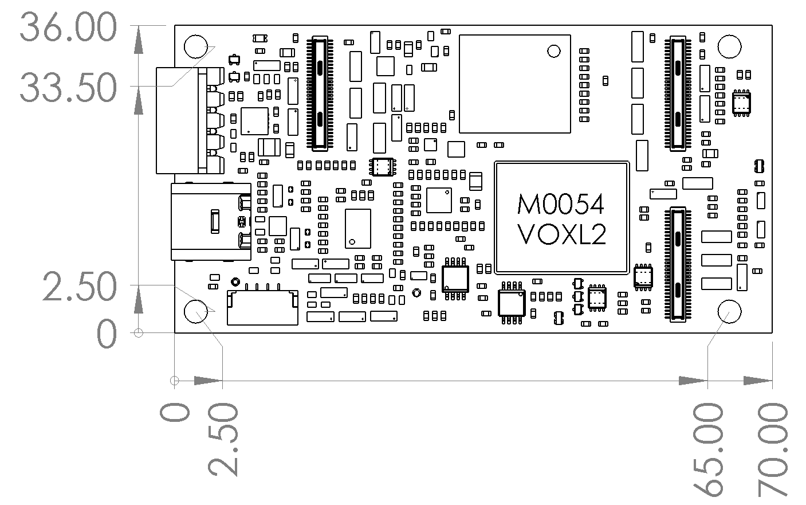

***Fan clearance reference.** Bottom-side outline, 70.0 × 36.0 mm. Confirm a 25 × 25 × 7 mm fan clears the frame before ordering — ModalAI/Livox documentation, retrieved 2026-10-09. Source: <https://docs.modalai.com/voxl2-mechanical-drawings/>*

**Measured on Starling 1, 2026-10-14.** Under an 8-core load in still air the board reached **102.7 °C** and held ~101 °C, with `cpu7` throttled from 2,841,600 to 844,800 kHz — a third of its clock. That is the QRB5165's thermal loop defending itself, which ModalAI calls normal and expected above roughly 95 °C. The alarming part is not the peak: **the very first sample already read 95 °C, before the artificial load began.**

The cause was stock services. With no artificial load at all, `top` showed `voxl-camera-server` at **95 %**, `voxl-qvio-server` at **48 %** and `px4` at 31 %. Stopping the first two dropped the board from **95 °C to 43.8 °C in twenty seconds** (an external fan came on at the same time, so the two effects are not fully separated — but a desk fan alone took a comparable board from 104 °C to ~80 °C, nowhere near 44 °C). The hottest thing afterwards was the PMIC at 45.0 °C, not the CPU.

**So the thermal problem on this aircraft is load, not cooling.** Roughly 1.4 cores are spent on two services your flight stack does not consume. You navigate on OptiTrack mocap, so VIO is dead weight — and Starling 2 already has `"en_vio": false` with `voxl-qvio-server` inactive, while Starling 1 is running it. Bringing Starling 1 into line with Starling 2 is a configuration change, not a hardware purchase.

This matches the field report exactly: a Starling 2 Max owner measured ~104 °C CPU and ~98 °C GPU at 96 % utilisation **sitting idle on a desk**, with `voxl-camera-server` at ~184 %, `voxl-qvio-server` at ~96 % and `px4` at ~90 %, while getting "Preflight Fail: High Accelerometer Bias" ([forum.modalai.com topic 5330](https://forum.modalai.com/topic/5330/questions-on-starling-2-max.md)). ModalAI's Eric Katzfey replied that the heat **may be causing the accelerometer bias error** and advised recalibrating with airflow over the unit. That is a flight-safety symptom, not a performance one. A second thread found the same shape: `voxl-portal` and `voxl-camera-server` consuming "an excessive amount", with the board heating rapidly whenever voxl-portal was open in a browser ([forum.modalai.com topic 4484](https://forum.modalai.com/topic/4484/temperature-issue-with-voxl-2.md)). Never leave voxl-portal open during a session.

**A fan is being fitted regardless, and the two measures are complementary rather than alternatives.** Trimming load removes the heat at source; the fan covers the bench, pre-arm and between-flight phases where there is no prop wash and where 95 °C was actually observed. Do both. The one number still unmeasured is the honest still-air idle figure with the camera and VIO services stopped and no external fan running — the 43.8 °C reading had airflow helping it — and it is now useful as a before/after reference for the fan rather than as a go/no-go.

The hardware choice is settled. ModalAI sells a 25 × 25 × 6.9 mm 5 V fan — Sunon **MC25060V1-000U-A99**, mating connector **SHR-02V-S**, ~3.0 CFM, ~5.0 g — for VOXL 2's **J2**, a 2-pin header whose pin 1 is permanently-on protected 5 V and pin 2 a **PWM-switched return limited to ~400 mA** ([ModalAI docs, thermal performance](https://docs.modalai.com/voxl2-thermal-performance/); [ModalAI docs, VOXL 2 Connectors](https://docs.modalai.com/voxl2-connectors/); [IBS Electronics](https://ibselectronics.com/products/sunon-fans/mc25060v1-000u-a99)). Use J2 and nothing else: J19 shares its 5 V with GNSS and the RC receiver, and the ESC main pads carry the unregulated 16.8 V bus. **No fan is fitted to J2 on either aircraft** — confirmed by inspection, since J2 has no tach line and software cannot report fan presence.

Control differs between the two aircraft, and not the way you would guess. The `voxl-fan` CLI exists on neither. But Starling 1's `/etc/modalai/voxl-cpu-monitor.conf` carries **`"fan_mode": "auto"`** with options `auto`, `off`, `max` and `slow`, while Starling 2's newer SDK replaced that schema (`en_auto_pitmode`, `normal_governor`, `pitmode_governor`, plus a `cool` governor) and **dropped `fan_mode` entirely**. The older aircraft is the better equipped for a stock-managed fan; how one would be driven on Starling 2 is undetermined. Whether Starling 1's setting actually drives J2 is untested, because no fan is fitted. `pwmchip0/2/5` exist but sit on the PMIC (`pm8150b`, `pm8150l`), none exported, none confirmed as J2.

Two cautions for whoever fits one. ModalAI has **no heatsink recommendation for VOXL 2** and warns that a bare heatsink without airflow "will effectively become a large thermal capacitor", and to avoid mechanical stress on the QRB5165 SIP ([forum.modalai.com topic 5103](https://forum.modalai.com/topic/5103/voxl2-thermal-throttling-and-heat-dissipation-methods)). Aim air at the **memory side**: ModalAI put the J3/J5 B2B connectors on the secondary side precisely so add-on boards would not block airflow over the LPDDR5, which sits above the CPUs and is the thermal bottleneck ([forum.modalai.com topic 2233](https://forum.modalai.com/topic/2233/voxl2-thermal-management)). And ModalAI's own measured experience is that **prop-wash routing beat vapor chambers and heatsinks by "many degrees C"** ([ModalAI docs](https://docs.modalai.com/voxl2-thermal-performance/)), so a fan's value is on the bench, pre-arm and between flights — which is exactly when 95 °C was observed.

On vibration: a constant-speed fan may suit the flight controller better than a thermostatic one, because fixed RPM gives a single stationary peak a static notch filter can remove while a variable-speed fan sweeps it. *That is engineering inference, not a sourced finding* — **no source anywhere addresses cooling-fan vibration coupling into a flight-controller IMU on any platform.** Mount to the frame on soft standoffs rather than to the board, and compare PX4 vibration metrics and raw-accel FFT across identical hover profiles with the fan on and off before trusting it.

Two reading errors to avoid, both of which caught us. The `soc` thermal zone reads **exactly 50.0 on both aircraft in every sample** — it is a placeholder, not a sensor; use the `cpu-*`, `apc-*` and `ddr-*` zones. And a core sitting below its maximum frequency under `schedutil` is **demand scaling, not throttling**: `cpu7` reads 844,800 kHz both when throttling at 95 °C and when idle at 44 °C. Only low frequency *together with* high temperature means throttling. Log `scaling_cur_freq` alongside temperature or the data cannot distinguish them.

## Props are a 7-inch consumable OddityRC already stocks

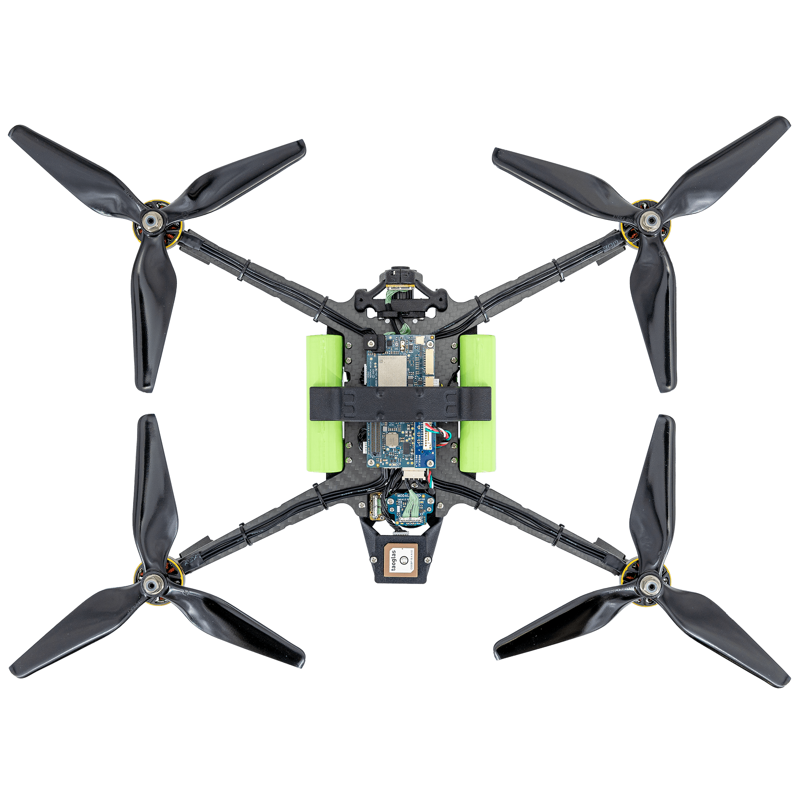

***Prop and motor layout.** Top-down view of the X-frame showing the four motor mounts and the tri-blade propeller arrangement — ModalAI/Livox documentation, retrieved 2026-10-09. Source: <https://www.modalai.com/products/starling-2-max (media position 7 in the product's Shopify media list)>*

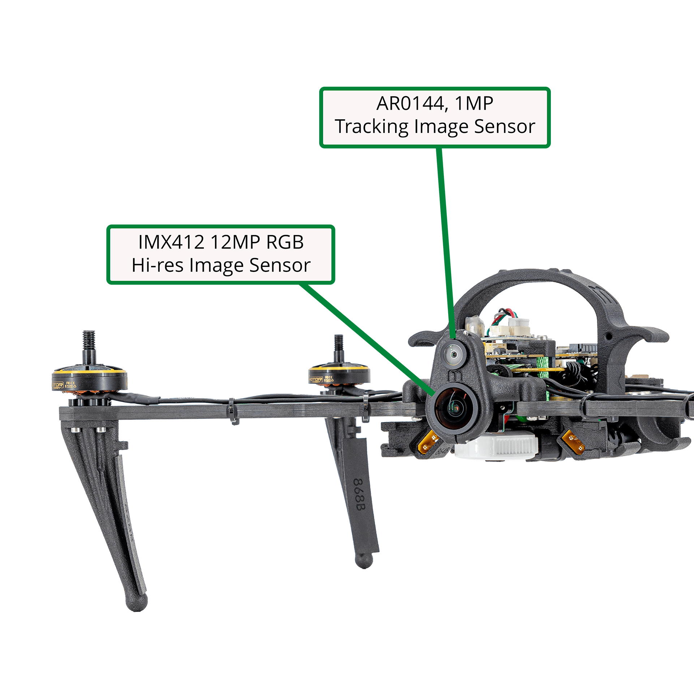

*ModalAI's own callouts for the IMX412 12 MP hi-res and AR0144 1 MP tracking sensors — the camera services that dominate the thermal load — ModalAI/Livox documentation, retrieved 2026-10-09. Source: <https://www.modalai.com/products/starling-2-max (media position 3)>*

ModalAI publishes little about the propeller, but the aircraft itself gives the spec. Both Starling 1 and Starling 2 carry `/usr/share/modalai/voxl-esc-params/D0012_Starling_MAX/`, and its parameter files end in `7x3.7x3`: **7 inch diameter, 3.7 inch pitch, three blades**. That matches the datasheet's **"180 mm Tri-Blade"** (180 mm is 7.09 in). The same propeller fits both aircraft, even though the two frames do not interchange. The store sells one SKU, **MRP-D0012-1-00, "Propellers, set of 4", US$29.99** ([ModalAI docs](https://docs.modalai.com/starling-2-max-datasheet/); [ModalAI docs](https://docs.modalai.com/starling-2-max-hardware-overview/); [ModalAI store](https://www.modalai.com/products/starling-2-max-replacement-parts)). Bore, hub thickness, material, weight, CW/CCW convention and manufacturer remain unpublished, and ModalAI's docs contradict each other on whether the prop folds (the hardware overview says "folding"). The geometry cross-checks: 322 mm motor diagonal plus 180 mm prop gives the stated 512 mm prop-tip-to-prop-tip. The separate "Propeller Nuts" (M10001405) line item implies a threaded shaft with a nut rather than a press-fit.

Small stators on 7-inch props are deliberate. 2203.5 (Starling 1) and 2204 (Starling 2) stators at 1500 kV on 4S swinging 7" props are unusually small: Gemfan's own 7" listings recommend **2806.5 1350 kV or "2808 and up"**. ModalAI is running a low-load, efficiency-biased combination to reach 40–55 min endurance at 566 g. The consequence is blunt: **fitting a high-pitch or "freestyle" 7" prop is the most likely single way to cook the motors or ESC.** Do not go up in pitch from stock.

For replacements, **OddityRC is a Singapore-registered FPV store at 60 Paya Lebar Road #11-53 Paya Lebar Square with an order pickup point**, stocking four Gemfan 7-inch props: **7035-2 Long Range US$3.29, 7035-3 Freestyle US$3.49, 7037-3 Cinelifter US$3.49, Flash 7040-3 US$2.99** ([oddityrc.com](https://oddityrc.com/); [OddityRC 7" props](https://oddityrc.com/collections/7-props)). The 7037-3 publishes real specs: **178.8 mm diameter, 3.7" pitch, 8.7 g, M5 centre hole, 7 mm centre thickness, reinforced carbon nylon** ([OddityRC](https://oddityrc.com/products/gemfan-7037-3-carbon-nylon-for-cinelifter-macro-quad)). Its diameter, pitch and blade count match the stock `7x3.7x3` spec, at about US$3 against ModalAI's roughly US$7.50 each. If the stock prop turns out to be a genuine folder, the closest analogue is the **Gemfan F7036 folding 3-blade — 177.8 mm, 3.6" pitch, 5 mm centre hole, 8.2 g, 7.25 mm centre thickness, aluminium hub, US$7.49/set** ([RaceDayQuads](https://racedayquads.com/products/gemfan-f7036-folding-3-blade-propeller-set-of-4-black)). **No Singapore source for a folding 7" was found**, so that would ship from the US or a marketplace seller. OddityRC prices in USD and quotes "parts typically arrive in 5–8 days", which does not read like same-day local stock; email before relying on it for a same-week resupply.

**No source confirms any third-party prop as a correct substitute for MRP-D0012-1-00**; a matching diameter, pitch and blade count is dimensional reasoning, not a ModalAI endorsement. ModalAI's position on tuning is explicit: "There is no need to re-calibrate the ModalAI ESC if you use a stock configuration, such as the motor + propeller that comes with Starling 2 MAX", and "the ESC with the correct params is tuned for this motor + propeller… I do not recommend trying to fix this by modifying ESC parameters" ([ModalAI forum](https://forum.modalai.com/post/19806)). For anything that changes mass or configuration, staff point at the generic PX4 tuning guides and say "we do not offer any additional information on that topic" ([ModalAI forum, adding payload to max2](https://forum.modalai.com/topic/5272/adding-payload-to-max2.md)). A same-diameter, same-pitch, same-weight swap should fly on the stock tune; different pitch or weight moves `CA_ROTORn_CT`, `MPC_THR_HOVER` and the rate-loop gains. Because the EKF is fed OptiTrack position, **a prop-induced vibration problem will not show up as position drift first. It will show as climbing IMU vibration metrics, EKF innovation spikes and attitude-loop oscillation.** Log `VIBE` and `estimator_innovations` on the first flight after any prop change, and keep one set of genuine ModalAI props as the known-good reference.

Props are a stocked consumable, not a just-in-time order. ModalAI quotes **60 business days** on a Starling 2 Max airframe ([ModalAI store](https://www.modalai.com/products/starling-2-max)), and spare props are not included in any kit.
## The Mid-360 doesn't fit under the ESC's rating; the compute path is unproven

*Deferred reference: the Livox/LiDAR workstream is on hold while LEDs, cooling and propellers take priority. Nothing in this section is active work.*


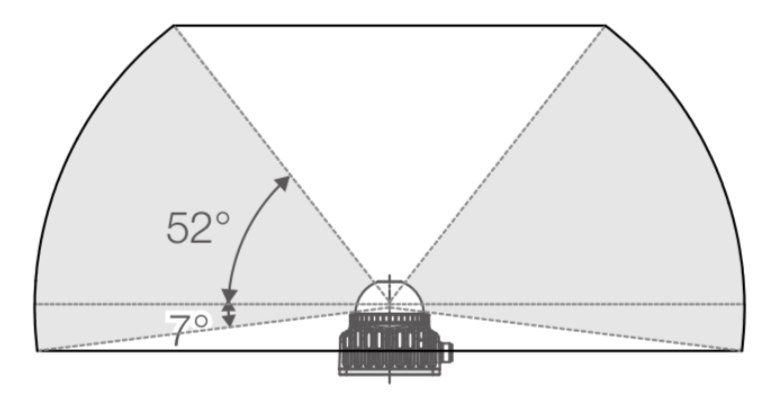

***The single most important picture for the mounting decision.** The Mid-360's vertical FOV is strongly asymmetric — it sees 52° *above* horizontal and only 7° below, with a blind cone directly overhead. Mounted upright on a mast it watches your hangar's roof trusses (feature-rich, good for LIO) while seeing almost nothing of the floor — ModalAI/Livox documentation, retrieved 2026-10-09. Source: <https://daystar.lenovo.com/docs/en/daystarBot/V2.4/SDKOverview/Services/LiDARServices.html>*

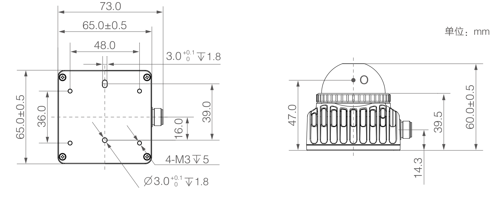

***Dimensions for the mast design.** 65.0 ± 0.5 mm square body, 73.0 mm across including the connector boss, 60.0 ± 0.5 mm tall — ModalAI/Livox documentation, retrieved 2026-10-09. Source: <https://daystar.lenovo.com/docs/en/daystarBot/V2.4/SDKOverview/Services/LiDARServices.html>*

### Payload: 265 g against ~184 g of ESC-rated margin

The Livox Mid-360 is the lightest Livox unit ([Livox Mid-360 specs](https://www.livoxtech.com/mid-360/specs)).

| Spec | Mid-360 |
|---|---|
| Mass | **265 g** |
| Body | **65 × 65 × 60 mm** |
| Power | **6.5 W average, 9–27 V DC** |
| FOV | **360° × (−7°…+52°)** |
| Minimum range | **0.1 m** |
| Output | 200,000 pts/s |
| Other | IP67, built-in ICM40609 IMU, PTPv2 and GPS sync |
| Interface | **100BASE-TX Ethernet** |

Every sibling is 2–4× heavier: Mid-70 580 g, Avia 498 g, HAP ~1120 g ([Mid-70](https://www.livoxtech.com/mid-70/specs); [Avia](https://livoxtech.com/avia/specs); [HAP](https://livoxtech.com/hap/specs)).

The datasheet states a **566 g takeoff weight and 500 g payload** ([ModalAI docs](https://docs.modalai.com/starling-2-max-datasheet/)), but its own "~930 g total" figure contradicts that, and the binding limit is the ESC: ModalAI designs the M0129 "for vehicles under 750 g" ([ModalAI M0129](https://www.modalai.com/products/voxl-esc-mini)), which leaves **~184 g**. A realistic installation — sensor, shortened harness, damped mount plate, Ethernet add-on, maybe a BEC — lands at roughly **375–500 g**; everything except the sensor's 265 g is an unverified estimate, as ModalAI and Livox publish no masses for the harness, M0062 or any mount. ModalAI's Alex Kushleyev calls a **250 g** payload "quite substantial", and for 500 g says "in ideal world, the flight time will be cut in half", with the real loss worse ([ModalAI forum](https://forum.modalai.com/topic/5272/adding-payload-to-max2)). Modelling hover power as roughly W^1.5 on a 43 Wh 4S pack gives **~12–18 minutes against 40 minutes stock** — *a calculation from published figures, not a measured or ModalAI number*.

**The Mid-360 alone exceeds the ESC margin, and so do the lighter LiDARs.** Unless ModalAI clears the M0129 above 750 g, onboard LiDAR SLAM needs a different airframe; see [Onboard compute alternatives 2026-10-20](Onboard%20compute%20alternatives%202026-10-20.md) §5. The rest of this section stays as reference for that airframe. Lighter alternatives, each still over the margin on this aircraft: the **Hesai JT16 at under 200 g and 4.3 W** ([Hesai JT16](https://www.hesaitech.com/product/jt16/)) and the **Unitree 4D LiDAR L1 at ~230 g and 6 W with a symmetric 360° × 90° FOV** ([Generation Robots](https://generationrobots.com/en/404133-unitree-4d-lidar-l1.html)), better suited to indoor flight than the Mid-360's upward bias. Both lose the mature Livox/FAST-LIO toolchain.

**Power.** The **9–27 V input spans the 4S rail directly**: tee an XT30 off the battery or ESC power module with a 1–2 A inline fuse, and **never** power it from a VOXL 2 5 V rail (6.5 W at 5 V is 1.3 A against a 1 A per-connector rating) ([Livox Mid-360 specs](https://www.livoxtech.com/mid-360/specs); [VOXL 2 connectors](https://docs.modalai.com/voxl2-connectors/)). Livox publishes no inrush figure (siblings show ~2× at startup), so power it after VOXL 2 has booted past its own 6 A inrush.

**Mounting.** A **top-centre mast** is the only viable location — the sensor is 60 mm tall and the aircraft lands on its underside — and ModalAI advises keeping added mass "as close as possible to the geometrical center" ([ModalAI forum](https://forum.modalai.com/topic/5272/adding-payload-to-max2)). Do not soft-mount: **265 g on a compliant mount atop a tall mast is a pendulum whose rocking mode may sit in the 5–15 Hz band, inside a small quad's attitude bandwidth**. Start stiff and measure the IMU spectrum. *This resonance reasoning is inference from standard multirotor practice; no quantitative study of Mid-360 IMU noise on a multirotor was found.*

### Interface: the VOXL 2 has no Ethernet, and nobody has done this

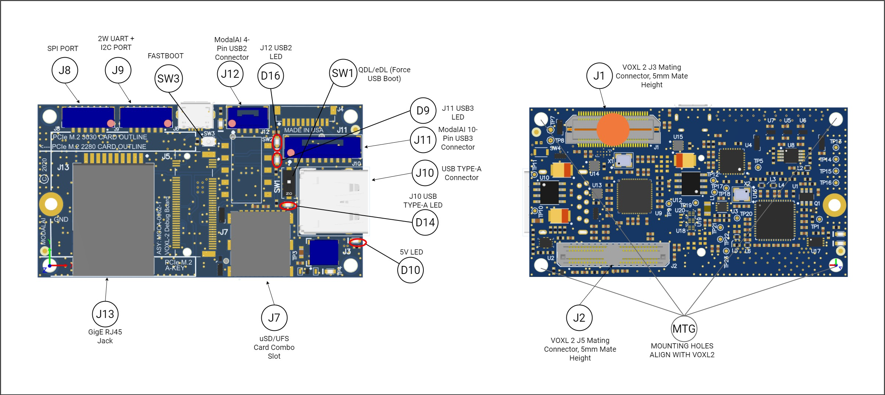

***The add-on the LiDAR would need.** M0062 Ethernet Expansion + USB Hub, annotated — J13 is the GigE RJ45 jack. Not listed as Starling 2 Max-compatible, and no one has confirmed it with a Mid-360 — ModalAI/Livox documentation, retrieved 2026-10-09. Source: <https://docs.modalai.com/m0062-datasheet/>*

The Mid-360 is ordinary 100BASE-TX, so no automotive-Ethernet converter is needed. But **the VOXL 2 has no native Ethernet port and no exposed MAC** ([VOXL 2 connectors](https://docs.modalai.com/voxl2-connectors/)). The sanctioned path is the **M0062 "VOXL 2 Ethernet and USB Hub Add-on", US$259.99**, plugging into J3/J5 as `eth0` ([ModalAI M0062-2](https://www.modalai.com/collections/expansion-board/products/m0062-2); [M0062-2 docs](https://docs.modalai.com/m0062-2/)). ModalAI staff describe it as a **USB-to-Ethernet bridge** on a **USB2 backhaul**, with RJ45s "more vulnerable to shock failure than typical RJ45's" ([forum.modalai.com](https://forum.modalai.com/topic/2944/datasheet-for-voxl2-ethernet-expansion-and-usb-hub-addon.md)). Users report dead units, the board has **no link LEDs**, and port J10 "is not working consistently… for USB3 speeds" ([forum](https://forum.modalai.com/topic/3844/add-on-ethernet-hat-eth0-rj45-port-not-creating-a-network-connection.md); [M0062 user guide](https://docs.modalai.com/m0062-user-guide/)). Bandwidth is fine at **~24 Mbit/s** ([Livox Ethernet protocol](https://livox-wiki-en.readthedocs.io/en/latest/tutorials/new_product/mid360/livox_eth_protocol_mid360.html)).

The precedent problem is more serious. **ModalAI staff have twice stated they have no experience with this sensor.** Eric Katzfey: "We have no experience with this sensor" ([thread 4196](https://forum.modalai.com/topic/4196/clarification-on-livox-mid-360-lidar-compatibility-with-voxl-2-on-starling-2-max-outdoor-drone.md)). A second thread got "if you use an ethernet to USB adapter, you should be able to get a network connection" ([thread 4660](https://forum.modalai.com/topic/4660/integrating-lidar-sensor)). Neither ends in a confirmed integration, and **there is no ModalAI-supported LiDAR driver in the VOXL SDK or MPA at all**. You will be first.

Time sync is manageable. The Mid-360 supports **PTPv2, gPTP and GPS/PPS** ([Livox time sync](https://livox-wiki-en.readthedocs.io/en/latest/tutorials/new_product/common/time_sync.html)); indoors the VOXL 2 becomes grandmaster over a link without hardware timestamping, so software PTP at tens of microseconds to milliseconds. That suffices: points-to-IMU alignment is solved inside the sensor, and LI-Init estimates the residual offset.

### Software: FAST-LIO2 on paper, with a real ROS 1/Foxy/Jazzy problem

`livox_ros_driver2` officially builds on **ROS 2 Foxy, Humble and Jazzy** ([README](https://raw.githubusercontent.com/Livox-SDK/livox_ros_driver2/master/README.md)), so the Foxy-onboard/Jazzy-ground split is a DDS interoperability problem, not a driver-availability one; the repo's plain-UDP convention for onboard add-ons sidesteps it.

FAST-LIO2 is the right default. It is the only candidate with **published ARM benchmarks**: on a Khadas VIM3 (4× Cortex-A73 @ 2.2 GHz) it averages **45–66 ms/scan on Livox Horizon data**, and the authors state it "can also achieve 10 Hz real-time performance" on ARM ([FAST-LIO2 paper](https://ar5iv.labs.arxiv.org/html/2107.06829)). Scaling to the QRB5165's ~3 GHz cores suggests ~20–65 ms/scan, which fits 10 Hz but not with headroom while PX4, MPA and the camera pipelines run. **That is extrapolation, not measurement; VOXL 2 CPU headroom is the gating unknown.** It has no loop closure. GLIM is ROS 2-native but "required GPU acceleration for real-time processing" ([arXiv:2505.01017](https://arxiv.org/pdf/2505.01017)). Point-LIO is ROS 1 only and **does not name the Mid-360** ([Point-LIO GitHub](https://github.com/hku-mars/Point-LIO)). The deciding problem: FAST-LIO2 and Point-LIO are ROS 1 catkin projects, the only ROS 2-native option wants a GPU and Ubuntu 22.04+, and **VOXL 2 cannot run Ubuntu 22.04** — "it is not possible to update to Ubuntu 22.04 on the VOXL 2 autopilot" ([forum.modalai.com](https://forum.modalai.com/topic/2664/sentinel-voxl2-update-ubuntu-from-18-04-to-20-04.md)).

**EKF2 in PX4 v1.14 subscribes to exactly one external-vision topic, `vehicle_visual_odometry`**; `vehicle_mocap_odometry` exists but EKF2 does not read it ([EKF2.hpp](https://github.com/PX4/PX4-Autopilot/blob/v1.14.0/src/modules/ekf2/EKF2.hpp); [external position estimation](https://docs.px4.io/v1.14/en/ros/external_position_estimation.html)). Mocap and SLAM cannot be fused: they contend for one channel, and arbitration must live outside PX4. `EKF2_EV_CTRL=11` suits a pose-only mocap feed; a SLAM source supplying velocity opens up `15`. `EKF2_EV_DELAY=50` must be **re-measured, not inherited**: an onboard FAST-LIO2 pipeline plausibly runs 70–130 ms. With `EKF2_EV_NOISE_MD=0` the EKF honours the message's `position_variance`, and `EKF2_EV_QMIN` plus the `quality` field lets PX4 stop fusing a sick solution ([ekf2_params.c](https://github.com/PX4/PX4-Autopilot/blob/v1.14.0/src/modules/ekf2/ekf2_params.c)). A SLAM bridge **must** increment `reset_counter` on any pose discontinuity.

**Degeneracy is the failure mode to design for**, and an indoor hangar is close to the worst case. The canonical bad environments are "corridors or open fields" ([D²-LIO, arXiv:2508.14355](https://arxiv.org/pdf/2508.14355)); a hangar combines both, and mid-volume the Mid-360's 40 m @ 10 % reflectivity may reach nothing structured. Mitigation: **put boxes, pillars and equipment in the volume to break translational symmetry.** The registration Hessian's minimum eigenvalue falls as constraint is lost ([KNS tunnel study](https://www.kns.org/files/pre_paper/55/26S-497-심수곤.pdf)); **whether FAST-LIO2 exposes it without a source patch was not verified**. If EV stops, with `EKF2_GPS_CTRL=0` and `EKF2_BARO_CTRL=0` the estimator has **nothing left**. SLAM can be **confidently wrong**, drifting smoothly while the aircraft holds a slowly moving position, which mocap cannot do; the existing iron rules matter more, not less.

**Validation sequence.** Carry the sensor with the same mocap markers, record synchronised Livox + OptiTrack bags, run FAST-LIO2 offline and compute ATE against mocap. **The mocap volume is worth more as an independent scorer than as a second input.** Then run SLAM live in shadow mode for weeks, publishing nowhere near PX4, recording drift, yaw behaviour and occlusion recovery. Only then attempt a props-off bench cutover. *This staged plan is engineering judgement; no published procedure for mocap-validated SLAM cutover on PX4 was found.*

## AirStack already carries the LiDAR path; pose and local avoidance are the gaps

Invert the mental model you probably started with. A complete LiDAR chain is already wired and the default **in the tree you fly**: Isaac Sim's RTX Ouster OS1 publishes to `sensors/ouster/point_cloud_raw`, `lidar_point_cloud_filter` cleans it onto `sensors/ouster/point_cloud`, and `vdb_mapping_ros2` consumes that as its only active source (`global_bringup/config/vdb_params.yaml`, `sources: [lidar]`). The `sensors` test mark probes the filter chain only (and only under `SIM_TYPE=isaacsim`); nothing in `tests/` exercises `vdb_mapping`, the planners or `odometry_conversion`. **LiDAR → vdb_mapping → global planning is already default and CI-tested at the filter level; LiDAR → pose and LiDAR → local obstacle avoidance are the gaps** — and only the first is on your roadmap.

AirStack vendors no LiDAR driver, so a real Livox install is three artifacts: the vendor driver (`livox_ros_driver2`, yours to supply); a thin sensor-layer package or pure remap onto `sensors/ouster/point_cloud_raw`; and a URDF link plus fixed joint giving the cloud a TF frame, as `iris_with_sensors.pegasus.robot.urdf` does for `ouster`. A LiDAR landing on `sensors/ouster/point_cloud` or `sensors/lidar/point_cloud` needs **zero** downstream changes. Silent traps: config topics must be absolute (`/$(env ROBOT_NAME)/sensors/...`), the YAML must load with `allow_substs="true"`, and a best-effort subscriber under a reliable-only publisher receives nothing.

**Pose injection.** The canonical odometry topic is not what AirStack's own `AGENTS.md` says. That table advertises `/{robot_name}/odometry`; the [Interface Conventions Specification](https://raw.githubusercontent.com/castacks/AirStack/main/docs/robot/autonomy/interface_conventions.md) calls plain `odometry` a **v2 target** that does not exist yet, and every real consumer (safety monitor, PID, DROAN, `random_walk`, trajectory controller, task servers) subscribes to **`/{robot_name}/odometry_conversion/odometry`**, as `local_bringup/launch/local.launch.xml` confirms. Publish `nav_msgs/Odometry` (RELIABLE, pose in `map` as ENU metres, twist in body frame) on `perception/<your_estimator>/odometry` and point `odometry_conversion`'s `odometry_in` at it; it restamps the frames and broadcasts `map → base_link` ([adding_a_state_estimator.md](https://raw.githubusercontent.com/castacks/AirStack/main/docs/robot/autonomy/perception/adding_a_state_estimator.md)). `interface_odometry_in_topic` exists only in `interface_bringup/launch/interface.launch.py`, the MAVROS path; the PX4/uXRCE-DDS path you fly hardcodes the remap in `px4_interface.launch.xml` and `drone_interface.launch.xml`, so there it is a small launch-file edit. The precedent is vendored: `perception/macvo_ros2/`, a stereo VO estimator in exactly the slot a LIO node would occupy.

**You need two injection points**, which no document spells out. The one above feeds the AirStack autonomy graph. The other feeds PX4's EKF2 through a seam already in `px4_interface.launch.xml`, commented out: `<!-- <remap from="visual_odometry_in" to="/$(env ROBOT_NAME)/vio/odometry" /> -->`. PX4 needs a pose to hold position; AirStack needs one to plan against. The mocap bridge occupies the PX4-side seam, which is why mocap-as-scorer works: drive the AirStack side from SLAM while PX4 flies on mocap, and compare.

**Compute placement.** `docs/robot/autonomy_modes.md` states the **VOXL2 profile is always `onboard`** ("it does not have sufficient compute for global planning"); `AUTONOMY_ROLE` only lets global planning move offboard. Perception is onboard in every role and odometry is "produced onboard", so link loss still allows failsafe. AirStack's own rules therefore put SLAM on a board its docs call compute-limited, carrying interface, sensors, perception, local planning and behaviour **plus** FAST-LIO2; ground-station SLAM means hand-editing `dds_router`/`domain_bridge` configs. Foxy vs Jazzy is unaddressed: AirStack lists VOXL 2 as supported with a `voxl` compose profile, implying its own Jazzy container — **unverified and important**.

**Local avoidance** is the one genuinely hard integration and can be deferred. DROAN is a disparity-space planner; the variant your branch runs, `droan_gl`, works in OpenGL shaders on stereo disparity with no plugin seam, and the CPU `droan_local_planner` block in `local.launch.xml` is disabled behind `<?ignore ?>`. Upstream says "a local planner and its world model are a matched pair". The one blessed extension is the pluginlib `cost_map_interface`, so a VDB-backed plugin plus re-enabling that planner is the smallest honest path — but **`cost_map_interface/README.md` is empty** in your tree. Upstream's answer is the `mighty` module (`>=0.20.0-alpha.16 <0.21.0`), built for the stacks-and-modules AirStack your branch is not.

**Simulation** proves plumbing, not drift. `ENABLE_LIDAR=true` spawns an RTX OmniLidar (Ouster, Velodyne VLP16 profiles). Sim covers topic names, QoS, TF and the odometry rewiring, but Pegasus and PX4 SITL supply ground-truth odometry, so SLAM competes against a perfect estimate.

**Two caveats.** **Branch currency**: your `yikuan/SVG_ground_control` snapshot predates upstream's stacks-and-modules refactor, so upstream CLI verbs (`airstack stack new`, `airstack module add`, `airstack doctor`, `airstack test -m wiring`) are absent and `adding_a_state_estimator.md` does not exist locally (`mkdocs.yml:113` points at a renamed page). **TF ownership is undesigned**: `robot.launch.xml` publishes a static `world → map`, `odometry_conversion` broadcasts `map → base_link`, and most SLAM packages want `map → odom`. Nothing in either tree says who owns what; a SLAM node publishing its own tree will collide.

## Singapore adds 9 % GST, no ModalAI distributor and no Livox dealer

Three procurement facts shape everything. First, **there is no ModalAI APAC distributor** — targeted searches returned nothing — and ModalAI ships direct from San Diego in USD, with most catalogue items quoted at ~10 business days and the airframe at 60 ([ModalAI contact](https://www.modalai.com/pages/beta-contact-us); [ModalAI store](https://www.modalai.com/products/starling-2-max)). Critically, the replacement-parts page states **"Each order ships the selected part only"**, which means five different spares generate five shipments and five sets of international freight. Consolidate. Second, **everything ModalAI sells here is ECCN EAR99, HTS 8807.30 / 8806.22.0000, origin USA** ([ModalAI store](https://www.modalai.com/products/starling-2-max-replacement-parts)) — not ITAR, not on the Commerce Control List, so a shipment to a Singapore civil research lab is an ordinary commercial export ([Shipping Solutions](https://shippingsolutionssoftware.com/blog/ear99-isnt-a-free-pass-for-export-compliance)). Expect a routine end-use question and nothing more. Third, **9 % GST applies to essentially every import with no useful de-minimis** since the Low-Value Goods regime took effect (8 % from 1 Jan 2023, 9 % from 1 Jan 2024, applying to goods ≤ S$400 from GST-registered overseas suppliers) ([Sovos](https://sovos.com/en-gb/blog/vat/singapore-updates-low-value-goods-gst-policy)); above S$400 it is collected at clearance instead, usually with a courier handling fee ([Passport Global](https://passportglobal.com/blog/2023-singapore-import-tax-changes)).

*LiDAR-specific items (deferred).* **No authorised Singapore Livox distributor was found and no SGD price exists**; livoxtech.com/dealer returns 404. The nearest regional channel is Optimus Control Industry in Kuala Lumpur ([optimuscontrol.com](https://www.optimuscontrol.com/showproducts/productid/5854251/cid/544490/livox-mid40-mid70-mid360-compact-3d-lidar-sensor/)). Overseas resellers list the unit at **US$852–899** (Livox list US$979) ([sonnyrobotics.com](https://sonnyrobotics.com/products/livox-mid-360); [roboticscenter.ai](https://www.roboticscenter.ai/ar/store/product/livox-dji-livox-mid-360); [robotopian.com](https://robotopian.com/collections/livox-lidar); [livoxtech.com](https://www.livoxtech.com/news/mid360_launch)). Budget roughly **S$1,100–1,300 before freight and GST**. A reseller says the original Mid-360 "is being phased out", pushing the **MID-360S**, and a cheaper **MID-360L** has been announced ([DroneXL](https://dronexl.co/2026/09/21/livox-mid-360l-lidar-half-point-rate-robots/)). The 360L drops multicast support and the 360S arrived in `livox_ros_driver2` 1.2.6, so confirm driver and FAST-LIO2 compatibility for whichever variant you buy. For a Singapore partner, ask cs@livoxtech.com.

On export control, Singapore's **Strategic Goods (Control) Act regulates export, transhipment, transit, intangible technology transfer and brokering, not import** ([Singapore Customs](https://www.customs.gov.sg/permits-and-licences/trade-controls-and-prohibitions/strategic-goods-control/)). Importing a Livox for use in Singapore does not trigger it; **taking a LiDAR-equipped aircraft out of Singapore might**, and whether a specific Livox falls under a controlled sensors-and-lasers code was not determined — look it up before any conference demo travels. Enforcement is real ([WorldECR](https://www.worldecr.com/?p=2027273)). Separately, **no CAAS rule covering import or purchase of drone spare parts or LiDAR was found**, but no CAAS page confirming the absence was retrievable either, so treat that as unverified.


## What to order

Everything below is for the three active workstreams. The LiDAR items are deferred and deliberately absent.

### Cooling — one part, ModalAI-specified

| Item | Part | Notes |
|---|---|---|
| Fan | **Sunon MC25060V1-000U-A99**, 25 × 25 × 6.9 mm, 5 V, ~3.0 CFM, ~5.0 g | The fan ModalAI itself specifies for VOXL 2 |
| Connector | **SHR-02V-S** (mating half for J2) | J2 is pin 1 protected 5 V, permanently on; pin 2 a PWM-switched return limited to ~400 mA |

**Can a generic fan substitute?** Mostly yes, but **J2 switches the LOW side** — pin 1 is permanently-on 5 V and pin 2 is the PWM-chopped ground return. That makes the wire count a hard constraint, not a preference:

| Must match | Spec | Why |
|---|---|---|
| Wires | **2 only** | A **4-wire** fan expects constant power plus a separate PWM *signal* pin; chopping its ground browns out its internal controller. A **3-wire** fan's tach is referenced to the chopped ground and has nowhere to connect |
| Voltage | **5 V** | Many 25 mm fans are 12 V. Easiest mistake to make |
| Current | **≤ ~400 mA**, inrush included | J2's return is limited to roughly 400 mA, and fans pull 2–3× that at startup. Aim for ≤150 mA running |
| Envelope | **25 × 25 mm**, ≤ 7 mm thick | Unverified against the frame — check before ordering |

Flexible: airflow (~3.0 CFM is a reference, not a requirement), brand, blade count. Worth paying for anyway: a **ball bearing** rather than sleeve (sleeve bearings want a vertical shaft and wear badly under vibration), and a well-balanced unit, since an imbalanced fan adds a vibration source near the IMU. Expect to **re-terminate** — J2 mates with **JST SH 1.0 mm**, while most fans ship with bare leads or the larger JST PH 2.0.

Low-side PWM works with simple 2-wire fans — it is how cheap fan speed control has always worked — but some brushless fans with fussier internal electronics stutter or will not start at low duty. The Sunon part is known-good because ModalAI specified it against this header; a generic substitute is low-risk rather than zero-risk, and the failure mode is "will not spin at `slow`", not damage.

Fit to **J2 and nothing else**: J19 shares its 5 V with GNSS and the RC receiver, and the ESC main pads carry the unregulated 16.8 V bus. Confirm the 25 × 25 × 7 mm envelope clears the frame before ordering — neither aircraft has a fan fitted, so there is no precedent to copy. On Starling 1, try stock `fan_mode: auto` in `voxl-cpu-monitor.conf` first; Starling 2 has no equivalent setting and how a fan would be driven there is undetermined.

### LED strip — chipset is the only real decision

| Item | Choose | Notes |
|---|---|---|
| Strip | **SK6812 RGBW** *or* **WS2812B**, any brand | **The model does not matter, the chipset does.** Must be individually addressable, single-wire, 5 V nominal. Brand, PCB colour, IP rating and reel length are all free choices. SK6812 RGBW matches the daemon's default (`rgbw=True`); WS2812B is cheaper and far more stocked, and the `--rgb` flag exists for exactly that. Cytron notes its own strip "may ship with either WS2812B or SK6812-based LEDs… the same brightness, color, and protocol" |
| Density | **60 LED/m** | 16.7 mm spacing: 4 pixels = 67 mm, which fits the **~75 mm arm** (owner-measured 2026-10-20). 30/m fits only 2 per arm. For 6 per arm you need 96/m (62.5 mm) or 144/m (42 mm) |
| Length | **16 pixels** (4 × 4 arms), ≤ 32 firmware-enforced | Currently configured for 11. One 1 m strip is 60 px, so there are plenty of spares for bad cuts |
| Width | **As narrow as available — 5 mm ideal, 10 mm max** | The arms are ~10 mm wide, tapering toward the motor (owner-measured 2026-10-20). A 4-pixel run covers 67 of the 75 mm, so it reaches the thin end. A 5 mm "narrow" strip sits flush. A standard 10 mm bare strip will overhang slightly near the motor; overwrap with Kapton. **No silicone-sleeved strip**: Cytron's is 14.5 mm |
| Resistor | **330–470 Ω**, one per data line | Series, at the ESC end. The data pin is a raw 3.3 V STM32 GPIO with no level shifter |
| Pigtail | 3-wire, to solder to the M0129 pads | ⬇ data, ➕ power, `G` ground. **There is no connector** |

**Do not buy** APA102 / DotStar / SK9822 / WS2801 — they need a clock line the ESC does not provide. **Do not buy** WS2815 — 12 V, wrong voltage domain.

⚠️ **The one open question is the ➕ pad voltage.** The M0129 datasheet says **3.3 V** with the 5 V select GPIO firmware-disabled, which under-volts a 5 V strip. That is survivable at the configured `brightness 80/255` and a short strip, but anything longer or brighter needs its own 5 V BEC with grounds tied. Measure the pad with a multimeter when the aircraft is open, before committing to a strip length.

Cytron (Singapore) stocks 60 LED/m SK6812/WS2812B silicon strip and notes the product "may ship with either WS2812B or SK6812-based LEDs… the same brightness, color, and protocol" ([Cytron SG](https://sg.cytron.io/p-sk6812-60-led-silicon-strip-1m)).

### Four-arm LED build (the segmented-indication design)

**One chain, not four.** WS2812 is a daisy chain, and the M0129 has a single NeoPixel output, so four independent channels are not available. Route one chain out and back through each arm in turn:

```
ESC ⬇ ─▶ [arm 1: px 0–3] ─▶ [arm 2: px 4–7] ─▶ [arm 3: px 8–11] ─▶ [arm 4: px 12–15]
```

Each pixel regenerates the signal, so every pixel stays **independently addressable by index** — arm 1 red while arm 3 is green. Fanning the data line to four parallel strips would instead make all four show the *same* pattern, and would load one 3.3 V GPIO with four times the capacitance. Physically the chain must return to the hub between arms (arm 1's DOUT has to reach arm 2's DIN), so budget four outbound strip runs plus three 3-wire return runs through the hub; the returns are plain wire, not LEDs.

**Four pixels per arm, because that is what fits.** The arms are ~75 mm long (owner-measured 2026-10-20, not the ~200 mm this section first assumed), and 4 pixels at 60 LED/m take 67 mm. Sixteen pixels leaves ample headroom under the 32-pixel firmware cap and, more importantly, under the current budget. Four pixels is still plenty for colouring each arm on its own. If you want six per arm, use 96/m or 144/m strip. The count goes to 24 and the "× 24" figures in earlier revisions of this table apply. For SK6812 RGBW (R/G/B ~8 mA each, W ~16.5 mA):

| Case | Per pixel | × 16 | × 32 | vs the 500–600 mA rail |
|---|---|---|---|---|
| Single colour @ `brightness 80/255` | ~2.5 mA | ~40 mA | ~80 mA | comfortable |
| Full white @ `80/255` | ~12 mA | ~190 mA | ~400 mA | marginal at 32 |
| Full white @ 255 | ~40 mA | ~640 mA, **still over** | ~1.3 A | **far over** |

⚠️ **Voltage drop is the reason four arms is the case where a separate BEC stops being optional.** The rail is **3.3 V feeding a part specified for 5 V**; WS2812B/SK6812 misbehave below roughly 3.5 V, so the strip is under-spec before any wire resistance. Add the arm runs (~75 mm each) plus the return wires through the hub to the far arm and the last pixels may be dim, colour-shifted or dark. Measure the ➕ pad first; if it reads 3.3 V, feed the strip from its own 5 V BEC with grounds tied and keep only the data line coming from the ESC. Inject power at both ends if you do run 32 pixels off the ESC rail.

**Strip density: 60 LED/m.** At 16.7 mm spacing, 4 pixels covers 67 mm and leaves ~8 mm on a 75 mm arm for the solder joint and the heat-shrink overwrap. Cut only on the copper pads between pixels. 30/m would give only 2 pixels per arm. It is also the density Cytron stocks locally.

**Software change required.** The daemon currently drives the whole strip one colour: its UDP protocol carries a single `{"r","g","b","w","mode"}`. The packet builder underneath already accepts a per-pixel array (`build_neopixel_packet(led_data, num_leds, rgbw=...)`), so the capability exists and only the ground-side protocol needs extending — a `segments` field or a pixel array, in both `svg_led_daemon.py` and `led_controller.py`, plus a segment map from arm index to pixel range. Decide the semantics before soldering: arms can indicate heading, per-drone identity, or which direction the CBF is pushing, and that choice determines whether the map is body-fixed or world-fixed.

### Propellers — `7 × 3.7`, three blades

| Source | Part | Price |
|---|---|---|
| ModalAI (genuine) | **MRP-D0012-1-00**, set of 4 | US$29.99 |
| OddityRC (Singapore) | **Gemfan 7037-3** — 178.8 mm, 3.7" pitch, 8.7 g, M5 bore, 7 mm hub, carbon nylon | US$3.49 |

Same prop fits both aircraft despite the frames not interchanging. **Do not go up in pitch from stock** — 2203.5/2204 stators at 1500 kV on 4S are deliberately small and efficiency-biased; a high-pitch "freestyle" 7" prop is the most likely single way to cook the motors or ESC. Keep one set of genuine ModalAI props as the known-good reference, and log `VIBE` and `estimator_innovations` on the first flight after any prop change.

### Procurement notes

ModalAI ships direct from San Diego in USD with **no APAC distributor**, and the replacement-parts page states **"Each order ships the selected part only"** — five spares generate five shipments and five sets of freight, so consolidate. Everything is **EAR99 / HTS 8807.30**, origin USA: an ordinary commercial export to a Singapore civil research lab. **9 % GST applies to essentially every import** with no useful de-minimis. Props are a stocked consumable, not a just-in-time order — ModalAI quotes 60 business days on an airframe and spares are in no kit.

## What you must physically check on the hardware

The original list of twenty checks has mostly closed. A bench session on 2026-10-14, run over ADB on both aircraft and backed by the owner's inspection, answered most of them, so the answers are tabulated first and the open items follow as a short list.

**Settled**

| Question | Answer |
|---|---|
| Compute board | Both aircraft: `hw platform: M0054`, `mach.var: 1.0.1`, sysfs `machine=1 variant=0`. This is a **VOXL 2 M0054-1 with QRB5165M** (ModalAI's product photo shows an `M0154` silkscreen on this airframe; ModalAI calls the two functionally equivalent). Not the `-2` / QSM8250 assembly, so there is no four-camera cap. The aircraft differ only in accessories and software, with no per-board code paths. |
| SKU | Starling 2: `MRB-D0012-4-V4-C29-T9-M36-X0`. Starling 1 reports no `SKU:` line because its voxl-suite (1.4.1~beta3) predates SKU reporting. |
| WiFi hardware | Starling 1: `wlan0` on `rtl8852bu`, `lsusb` `35bc:0108` (TP-Link Archer TX20U after mode-switch). Starling 2: `mlan0` and `uap0` on the Marvell/NXP `MWLAN` driver. Starling 1's dongle sits behind a USB hub, on the 5G carrier (M0090-class) that holds its EM9291 card: its cable comes out of the carrier's `J12` USB 2 header (owner check 2026-10-20). |
| WiFi daughterboard | Starling 2 carries the Marvell/NXP B2B board, identified as Sparrow/M0213-class from the driver. This confirms the inference from naming convention. |
| Modem | Starling 1 has a Sierra Wireless EM9291 5G modem (`wwan0`, `cdc_mbim`); Starling 2 has none. Starling 1's `/etc/modalai/voxl-modem.conf` says `"modem_type": "quectel"`, which is wrong for this hardware. |
| Airframe revision | Starling 2 is **V4** (SKU above). Starling 1 is **V1–V3**, from the black-and-gold 2203.5 1500 kV motors and narrower mount spacing seen by the owner. The frames are not interchangeable: V1–V3 frame M10000929, motor M10000073, feet M10000868; V4 frame M10001459, motor M10001367, feet M10001460. |
| ESC | **M0129** on both, from the `m0129` parameter files in `D0012_Starling_MAX/`, a ModalAI staff forum post, and the fact that the M0138 is a 6S ESC on a 4S airframe. The `M0138` comment at `svg_led_daemon.py:62` is wrong; ESC ID 0 in the code is correct for either board. The governing datasheet is the **VOXL Mini ESC**: one NeoPixel output, a **3.3 V** LED pad at 500–600 mA (5 V select disabled in firmware), a 32-pixel cap, bare solder pads. |
| ESC telemetry | `px4-listener esc_status` works without stopping PX4. Four ESCs online at 16.07–16.09 V. `esc_address` reads 2,3,1,4, which is the PX4 motor number, not a fault. |
| Cameras | Both are **C29** with five cameras: two AR0144 tracking, two IMX412 hi-res, and an Infineon IRS2975 `pmd-tof-liow2` ToF. Both already own a short-range depth sensor. |
| Propeller | 7 inch, 3.7 pitch, three blades (`7x3.7x3`), identical on both aircraft. |
| Fan fitment | **No fan is fitted to J2 on either aircraft.** `voxl-fan` does not exist on either (voxl-utils 1.4.4 / 2.0.4). J2 has no tach line, so software cannot report whether a fan is present. |
| Fan control | **Starling 1 has thermostatic control**: `voxl-cpu-monitor.conf` carries `"fan_mode": "auto"` (options `auto / off / max / slow`). **Starling 2 does not**: its newer SDK replaced the schema and dropped `fan_mode`. The `pwmchip` devices found are all on the PMIC and none is confirmed as J2. |
| Thermal zones | The `soc` zone reads exactly 50.0 on both aircraft and is a placeholder, not a sensor. Use the `cpu-*`, `apc-*` and `ddr-*` zones. `voxl-cpu-monitor` flags above 90 °C and throttling begins near 95 °C. Cores idling below maximum under `schedutil` is demand scaling, not throttling. |
| Thermal baseline | **Not valid.** Every 2026-10-14 reading was taken with an external fan blowing on the aircraft (CPU/DDR 43–44 °C on Starling 2, 41–42 °C on Starling 1). Starling 2 was also in low-power mode (`en_auto_pitmode: true`, `cpu7 max=960000` against 2841600 on Starling 1). |
| Software baselines | Starling 1: system image 1.8.02, voxl-suite 1.4.1~beta3 (dev channel), voxl-px4 1.14.0-2.0.94. Starling 2: system image 1.8.08, voxl-suite 1.6.4~beta5, voxl-px4 1.14.0-2.0.142. PX4 is v1.14 on both. Neither aircraft's apt repo state is trustworthy, so do not run a casual `apt upgrade`. |
| LED toolchain | Both carry `voxl-esc`, `voxl-led`, `voxl-send-neopixel-cmd` and the ESC bench script. The `modal_io_bridge` FIFO is absent on Starling 2; `voxl_setup_led.sh:74` already falls back to a MAVLink TUNNEL. `svg_led_daemon.py` is not installed on either. |
| `MAV_SYS_ID` | 1 on both. Harmless flying one at a time, broken for simultaneous flight. |

**Still open**

1. **Voltage on the ESC ➕ LED pad**, measured with a multimeter and the aircraft powered. The datasheet says 3.3 V. This decides whether the LED build needs a level shifter and a BEC, or neither, and is planned for when the aircraft is opened to solder.
2. **Still-air thermal numbers, idle and 8-core loaded.** A soak with `scripts/thermal_soak.sh` is running. The fan decision is undecided until it reports; the condition that matters is still air on the ground (pre-flight, between flights, post-landing), because props move air in flight.
3. **ESC firmware version and M0129 dash variant (-5 or -65).** `esc_status` does not carry the firmware version, and earlier repo notes cite 39.21. Neither item affects anything buildable.
4. **Hover and flight thermal behaviour**, including what is consuming CPU in flight.
5. **Starling 1's J3 board part number.** Glue hides it; only "2021" is legible. The dongle on `J12` (USB 2) already identifies it as M0090-class, so this matters only when ordering a spare.
6. **Stack order.** The owner reports the ESC's LED solder pads are reachable just below the `J18` cable, which puts the ESC under the VOXL 2. A side photo of the stack would still pin down the exact order and add the missing side view to the wiring drawings.
7. **Clear arm length.** The owner measured ~75 mm; ModalAI's photo scales to ~104 mm. This decides between 4 and 6 LEDs per arm at 60 LED/m.

Several teardown-time items were never measured and stay unresolved until the aircraft is opened (the NeoPixel pads were confirmed reachable on 2026-10-20): whether the LED rail is independent of the rail feeding VOXL 2, strip weight and current at operating brightness, and clearance for a 25 × 25 × 7 mm fan on J2 (needed only if the soak says a fan is wanted). Prop hub moulding, folding versus one-piece, bore, hub thickness and weight have likewise not been read off the physical props, and whether `voxl-px4` streams `ONBOARD_COMPUTER_STATUS` and the kernel trip-point values have not been checked.

## Conclusion

The structure of this brief held up: four of the five workstreams are small, bounded and cheap, and one, onboard LiDAR, has no solution on this airframe under the ESC's 750 g rating. LEDs, cooling and props together cost well under S$200 and a few bench hours. The dominant risk in each was acting on a documentation assumption that inspection would overturn, and the bench session bore that out. The `mlan0` observation was predicted to mean a Marvell/NXP B2B board and is now confirmed by the `MWLAN` driver on Starling 2. The ESC was predicted not to be the M0138 and is the M0129. The two aircraft were predicted to differ at accessory level rather than board level, and both are the same M0054-1 with different WiFi, modem, frame revision and SDK. The cooling picture came out differently from the plan. The preferred strategy was a fan managed by the stock thermostatic service, and that service exists on Starling 1 (`fan_mode: auto` in `voxl-cpu-monitor.conf`). Starling 2, the newer aircraft, has lost it. The lesson is no longer a forecast: **ModalAI's documentation lags its hardware, the aircraft's own filesystem and the forum are better sources, and the newer SDK is not automatically the better-equipped one.**

Two decisions follow from what is now known. The fan decision waits on the still-air soak, and fan fitment is a choice rather than a repair, since neither aircraft has one. If the soak argues for a fan, Starling 1 can use stock thermostatic control; Starling 2 would need its own approach. The LED build waits on one multimeter reading.

For the LiDAR decision, the ESC settles the airframe question before compute does. ModalAI rates the M0129 for vehicles under 750 g, so no LiDAR fits on this aircraft, and onboard LiDAR SLAM means a different airframe ([Onboard compute alternatives 2026-10-20](Onboard%20compute%20alternatives%202026-10-20.md)) unless ModalAI clears the ESC for more. Ask them before buying anything. **That answer costs one email, not a S$1,300 sensor sitting in a drawer.** Meanwhile the asset most people in this position lack is already in hand: a calibrated mocap volume is a better SLAM scorer than it is a SLAM replacement, and it stays valuable long after LIO works. Its highest-value use is as the independent ground truth that shows, flight by flight, how far the new estimator has drifted.
